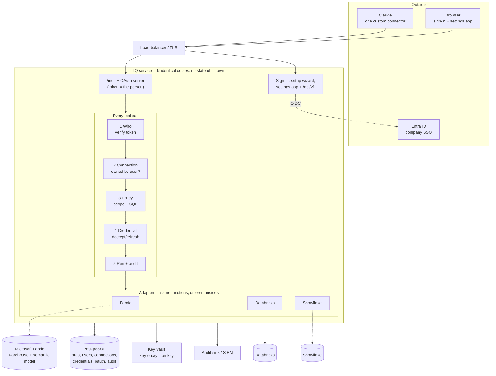
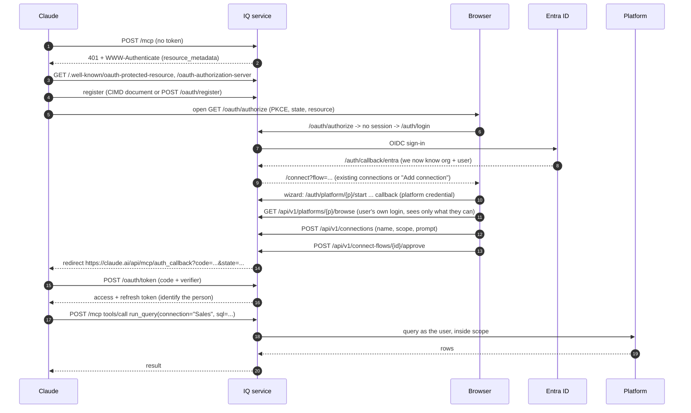

# IQ Connect architecture

Visual version: `architecture.html` (same folder). This file is the authoritative text.

## 1. In one picture



## 2. Core ideas
- **Person vs. connection.** Claude's access token identifies a *person* (our `users` row).
  A person owns many *connections*: `{platform, name, scope, custom_prompt, settings,
  credential}`. Every tool call names the connection. No "current platform" state exists.
- **Adapters.** Each platform implements the same interface; the core (pipeline, policy,
  audit) never knows which platform it is talking to.
- **Stateless.** Any copy serves any request. Warm DB connections are a per-copy cache keyed
  by connection id + credential version; losing them only costs speed.

## 3. Sign-in and setup flow



Later the person opens `/app/connections` (same SSO) to edit; changes apply on the next call.

## 4. Project structure

```
iq-connect (repo root)
├── runtime.txt, requirements.txt, requirements-dev.txt, alembic.ini, .env.example
├── docker/                 Dockerfile (builds web/ then the service), docker-compose.yml
├── src/iq_connect/
│   ├── main.py             create_app(): wires every router
│   ├── settings.py         typed env settings (pydantic-settings)
│   ├── db/                 models.py, session.py (pooled), migrations/
│   ├── security/           crypto.py (envelope), tokens.py (our tokens), web_session.py (cookie+CSRF)
│   ├── identity/           entra_sso.py (sign-in to OUR app)
│   ├── oauth/              metadata.py, clients.py (CIMD+DCR), authorize.py, token.py, revoke.py
│   ├── credentials/        service.py (store/decrypt/refresh under DB lock), providers/{entra,snowflake,databricks}.py
│   ├── connections/        service.py (CRUD + ownership), scope.py (in-scope checks)
│   ├── policy/             sql_guard.py (sqlglot), limits.py, org_policy.py
│   ├── adapters/           base.py (interface), registry.py, fabric/, databricks/, snowflake/
│   ├── execution/          pools.py, warm_cache.py, query_jobs.py
│   ├── mcp/                server.py (tools), pipeline.py, bearer.py
│   ├── api/v1/             me, platforms, credentials, connections, connect_flow, audit, admin
│   ├── audit/              logger.py
│   └── observability/      logging (incl. request-arrival trace), metrics
├── web/                    React + Vite: Connect, Connections, ConnectionWizard, ConnectionDetail, Audit, Admin
└── tests/                  unit/ (sql_guard attacks, scope, crypto, oauth), integration/ (fake adapter), e2e/
```

Layering is one-way: `mcp`, `api` -> `connections`, `policy`, `credentials`, `adapters` ->
`db`, `security`.

## 5. Routes and endpoints

### For Claude
| Method | Path | Purpose |
|---|---|---|
| POST | `/mcp` | MCP JSON-RPC, stateless. No/invalid token -> 401 + WWW-Authenticate |
| GET | `/.well-known/oauth-protected-resource` | resource = `<public>/mcp`, authorization_servers |
| GET | `/.well-known/oauth-authorization-server` | endpoints, S256, CIMD flag, grant types |
| POST | `/oauth/register` | DCR |
| GET | `/oauth/authorize` | start Claude sign-in -> our app |
| POST | `/oauth/token` | authorization_code, refresh_token (later jwt-bearer for EMA) |
| POST | `/oauth/revoke` | |

### Browser sign-in
| Method | Path | Purpose |
|---|---|---|
| GET | `/auth/login?next=` | redirect to Entra |
| GET | `/auth/callback/entra` | set session cookie |
| POST | `/auth/logout` | |
| GET, POST | `/auth/dev-login` | dev-only stand-in for Entra (404 unless `SSO_PROVIDER=dev`) |
| GET | `/connect?flow=` | server-rendered Connect page (built in step 5) |
| POST | `/connect/approve`, `/connect/deny` | form posts with CSRF token; 303 back to Claude |
| GET | `/auth/platform/entra/start`, `/callback` | link the person's Microsoft account (Fabric); refresh token stored encrypted. Built |
| GET | `/auth/platform/{provider}/...` | other providers: none built (see roadmap steps 8 and 10) |

### Built web pages and actions (server-rendered, no JS; every POST: session + CSRF + owner)
| Method | Path | Purpose |
|---|---|---|
| GET | `/` | landing (signed out) or dashboard: tiles, connection cards, activity, apps, setup |
| POST | `/app/connections/{id}/edit` | rename + notes |
| POST | `/app/connections/{id}/delete` | delete a connection (audit rows kept) |
| POST | `/app/connections/{id}/test` | Test connection through the real pipeline; result page |
| POST | `/app/demo-connection` | add the sample-data connection (dev) |
| POST | `/app/apps/disconnect` | revoke Claude's refresh tokens for this person |
| POST | `/app/microsoft/unlink` | remove the linked Microsoft account (KNOWN GAP: relinking doesn't reattach) |
| GET | `/app/connections/new` | wizard step 1: choose platform (`?flow=` when inside Claude's sign-in) |
| GET, POST | `/app/connections/new/demo` | demo: name + notes |
| GET, POST | `/app/connections/new/fabric` | Fabric: link -> workspace -> warehouse -> schemas -> name |

The JSON API below is the plan for a later React app; none of it exists yet.

### JSON API for the web app (`/api/v1`, cookie + CSRF)
| Method | Path | Purpose |
|---|---|---|
| GET | `/me` | user + org |
| GET | `/platforms` | allowed platforms + capabilities |
| GET | `/platforms/{platform}/browse?path=` | scope picker using the user's own login |
| GET, DELETE | `/credentials`, `/credentials/{id}` | linked platform accounts |
| GET, POST | `/connections` | list / create |
| GET, PATCH, DELETE | `/connections/{id}` | view / edit / delete |
| POST | `/connections/{id}/test` | trivial query |
| GET | `/connect-flows/{flow_id}` | Claude sign-in in progress |
| POST | `/connect-flows/{flow_id}/approve` | finish it; returns redirect to Claude |
| GET | `/audit?connection_id=` | my query history |
| GET, PUT | `/admin/policy` | org admin: allowed platforms/workspaces, limits |
| GET | `/admin/users` | org admin |
| POST | `/admin/users/{id}/revoke` | org admin: cut someone off |

### Web app pages (later React app)
`/app/connections/:id` (scope editing), `/app/audit`, `/app/admin` -- not built yet.

### Operations
`GET /healthz` (process up), `GET /readyz` (DB + Key Vault reachable), `GET /metrics` (internal).

## 6. MCP tools (same for every platform)
| Tool | Does |
|---|---|
| `list_connections` | name, platform, SQL dialect, scope, custom prompt for each connection |
| `list_objects(connection, path?)` | browse schemas/tables/views inside scope only |
| `describe_table(connection, table)` | columns, types, comments, row estimate |
| `run_query(connection, sql, max_rows?)` | read-only SQL; rows, or a query id if slow (>~25 s) |
| `get_query_result(query_id)` | fetch a slow query's result (NOT built yet: arrives with the first adapter that has async queries) |
| `query_semantic_model(connection, dax)` | only where the platform has the capability (Fabric, step 9; not built yet) |

Built in step 6: the first four. Every answer to Claude is text (markdown table for rows),
capped at MAX_RESULT_CHARS, and starts with the connection's notes when it has any.

SQL dialects differ (T-SQL / Databricks SQL / Snowflake SQL): `list_connections` reports the
dialect and errors name the expected one. The custom prompt is returned by
`list_connections` and repeated in that connection's results, because server-wide MCP
`instructions` cannot vary per connection.

## 7. Adapter contract

```python
class PlatformAdapter(Protocol):
    platform: str                 # "fabric" | "databricks" | "snowflake"
    dialect: str                  # sqlglot dialect: "tsql" | "databricks" | "snowflake"
    capabilities: set[str]        # {"sql"} or {"sql", "semantic_model"}

    def browse_scope(self, cred, path) -> list[ScopeNode]           # setup wizard
    def list_objects(self, conn, cred, path) -> list[DbObject]
    def describe_table(self, conn, cred, table) -> TableInfo
    def run_query(self, conn, cred, sql, limit) -> Rows | QueryId
    def get_result(self, conn, cred, query_id) -> Rows | Pending
```
The core runs these in the platform's thread pool; adapters are plain synchronous code.

## 8. Data model
| Table | Key fields |
|---|---|
| `orgs` | id, name, idp issuer/tenant, policy (allowed platforms/workspaces, limits) |
| `users` | id, org_id, idp subject (oid), email, is_admin |
| `credentials` | id, user_id, provider (entra, snowflake, databricks), ciphertext, wrapped_key, key_version, expires_at, version |
| `connections` | id, user_id, org_id, platform, name (unique per user), custom_prompt, scope (json), settings (json: role, row limit), credential_id, created/updated |
| `oauth_clients` | DCR clients (CIMD clients are fetched + cached) |
| `oauth_flows`, `oauth_codes` | in-progress sign-ins, one-time codes, with expires_at |
| `oauth_refresh_tokens` | hashed, rotated on every use |
| `audit_events` | time, user, connection, tool, query text, rows, ms, outcome (partition monthly) |

Credentials are per user + provider, not per connection: one Entra sign-in can serve a
Fabric and an Azure Databricks connection. Every row carries `org_id`; PostgreSQL
row-level security as a backstop.

## 9. Platform specifics
- **Fabric:** Entra delegated access (Fabric/Power BI scopes) via our stored Entra refresh
  token -> per-call access tokens (MSAL). Browse workspaces/warehouses/semantic models with
  the Fabric REST API as the user. SQL via pyodbc + ODBC Driver 18, token passed in
  `attrs_before={1256: token_struct}`, `ApplicationIntent=ReadOnly`. DAX via Power BI
  `executeQueries`. Scope = workspace id + warehouse id and/or semantic model id.
  Built (SQL part, connection reuse in `adapters/fabric/pool.py`); DAX not built.
- **Databricks:** not built. Planned: Azure Databricks with the linked Microsoft account (Entra
  token for the Azure Databricks resource); SQL via the Statement Execution API (async ids);
  scope = catalog + schemas; Unity Catalog grants apply as the user. PAT sign-in is blocked
  for Claude (see CLAUDE.md).
- **Snowflake:** not built. Stored username/password sign-in is blocked for Claude (see
  CLAUDE.md); planned alternative: External OAuth trusting Entra. Role is **pinned**: the chosen role is
  the only one ever used (`USE SECONDARY ROLES NONE`, then verify `CURRENT_ROLE()`); no
  fallback to the user's default role. A fresh login is slow (14-20 s seen) -> warm session
  cache keyed by connection + credential version. Async queries give query ids.

## 10. Security and governance layers
| Layer | Enforced by | Stops |
|---|---|---|
| 1 Platform permissions | queries run as the user; masking/RLS/grants apply | anything the user can't see |
| 2 Connection scope | every referenced table resolved to a full name and checked against scope; browse tools list in-scope only | other workspaces/catalogs the user *can* see but didn't pick |
| 3 SQL policy | sqlglot per dialect: exactly one statement, SELECT/WITH only; no DDL/DML, procedures, EXEC, OPENROWSET, COPY, external/file reads, cross-database names outside scope | writes, multi-statement tricks |
| 4 Tool surface | no write tools; read-only driver modes | being talked into writing |
| 5 Limits | row cap, timeouts, per-user (2 in flight) and per-org rate limits | runaway cost, bulk extraction |
| 6 Org policy | admin chooses allowed platforms/workspaces | unapproved data |

Also: audit every tool call (export to SIEM); nothing secret in logs; revocation via Entra
disable / connection delete / admin revoke; table contents may contain prompt injection --
read-only + tight scope limit the damage; query results leave the tenant to Claude, so the
company must agree data classes and retention with Anthropic.

## 11. Capacity (starting point, assumptions not measurements)
3 copies x 16 threads per platform; 2 calls in flight per person; 10 s wait for a thread then
"busy, retry"; 25 s before a query id is returned; 200 warm connections per platform per copy
(LRU, idle close 5 min); PostgreSQL pool 10 per copy. Assumes 1,000 users, ~10% active in a
busy minute, ~5 s per call -> ~20 concurrent calls average, 50-60 peak. Load-test to confirm.
