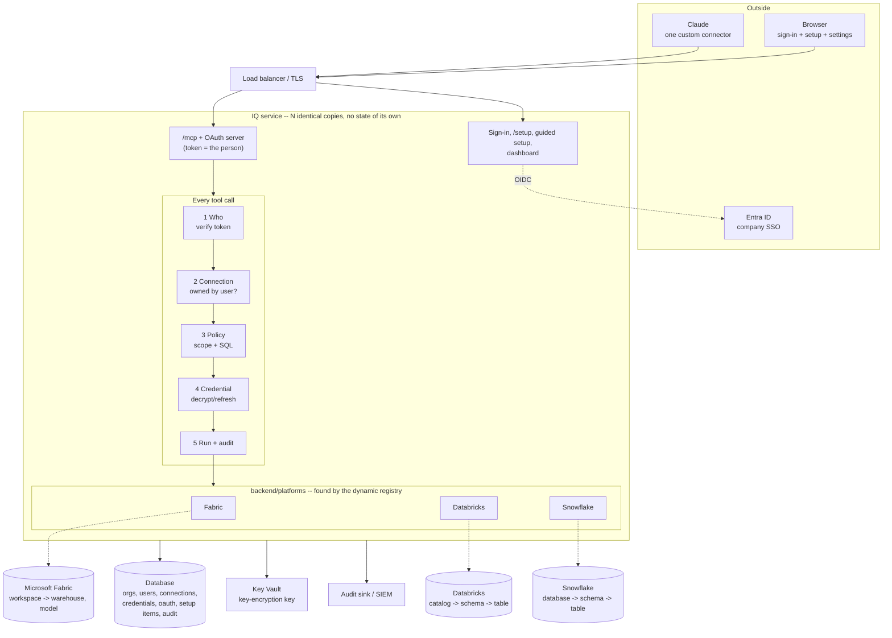
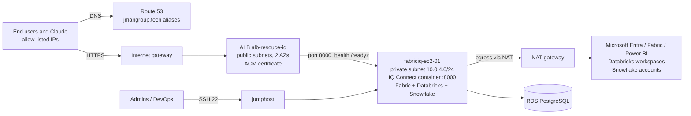

# IQ Connect

One Claude custom connector (one MCP server) for **Microsoft Fabric**, **Databricks** and
**Snowflake**, built by JMAN for JMAN and its clients: **any company** may use it. People sign
in with their company Microsoft account (Entra ID SSO; the first sign-in registers them),
choose how to sign in to each platform (Microsoft SSO by default, or the platform's own
alternative), pick the data resources Claude may use (a workspace, its SQL warehouses and
semantic models, the schemas inside them), and edit those choices later in the web app.
Every tool call runs inside that connection's scope, **read-only**, and is audited.

This is a fresh rebuild of an earlier prototype (see [Prior project](#21-prior-project));
it reuses the prototype's lessons, not its code.

**Contents**
1. [Status at a glance](#1-status-at-a-glance)
2. [Quick start](#2-quick-start)
3. [The original idea and the answers to its questions](#3-the-original-idea-and-the-answers-to-its-questions)
4. [Architecture](#4-architecture)
5. [Onboarding: adding IQ Connect to Claude and choosing data](#5-onboarding-adding-iq-connect-to-claude-and-choosing-data)
6. [What Claude can do: the tools](#6-what-claude-can-do-the-tools)
7. [Platform by platform](#7-platform-by-platform)
8. [Security and governance](#8-security-and-governance)
9. [Data model](#9-data-model)
10. [Routes and pages](#10-routes-and-pages)
11. [Configuration](#11-configuration)
12. [Project structure](#12-project-structure)
13. [Conventions for contributors](#13-conventions-for-contributors)
14. [Verification](#14-verification)
15. [Running locally with real Claude](#15-running-locally-with-real-claude)
16. [Claude connector rules learned the hard way](#16-claude-connector-rules-learned-the-hard-way)
17. [Capacity](#17-capacity)
18. [Deployment: Docker and AWS](#18-deployment-docker-and-aws)
19. [Roadmap](#19-roadmap)
20. [Known gaps, backlog and open decisions](#20-known-gaps-backlog-and-open-decisions)
21. [Prior project](#21-prior-project)

---

## 1. Status at a glance

"Verified" means run for real; "offline" means only checked without the real service (lint,
type checks, the app starting, or temporary test runs outside the repository). There is no
`tests/` folder any more (owner's decision, 2026-11-11): real verification is done with the
running service and `python -m backend.main check-connections` ([15](#15-running-locally-with-real-claude)).

| Piece | State |
|---|---|
| OAuth server for Claude (discovery, CIMD + DCR, authorize, token, refresh rotation) | **Verified with real Claude** (2026-10-15; Claude registered via CIMD) |
| MCP endpoint `/mcp`, tool pipeline, read-only SQL policy, audit | **Verified with real Claude** on the former demo data (2026-10-15) |
| Restructure into `backend/` (core / platforms / shared, dynamic platform registry), 2026-11-11 | Offline: the full former test suite (572) passed against the moved code before any behaviour changed; after the new behaviour, 542 tests passed (+1 expected failure) before `tests/` was removed (see [14](#14-verification)) |
| Any company may sign in (multi-tenant Entra, no tenant pinning, admins from `ADMIN_EMAILS`), 2026-11-11 | Offline only. **Never signed in against a real tenant yet** |
| Sign-in choice per platform (2026-11-11): Fabric SSO or service principal; Databricks SSO (Azure) or Databricks OAuth; Snowflake SSO (External OAuth) or Snowflake OAuth; each person's own workspace / account | Offline only (temporary tests with fake Microsoft / Databricks / Snowflake). **Never run against a real Fabric, Databricks or Snowflake account** |
| Web app: React + shadcn (`frontend/`), new Sign in step (2026-11-11) | Built, type-checked and linted; earlier screens rendered in headless Edge (2026-10-28). The Sign in step has not been looked at in a browser yet |
| Docker image + `docker-compose.yml` (PostgreSQL + the service on :8000) | **Image built and run with PostgreSQL 17 in WSL (2026-11-12)**: migrations created all 13 tables, `/healthz` + `/readyz` ok, `/mcp` 401 without a token, `check-config` reached Microsoft sign-in, Fabric and Power BI from the container, ODBC Driver 18 present. `docker compose` itself not run yet (the Compose plugin isn't installed in WSL) |
| PostgreSQL | Migrations verified on PostgreSQL 17 (2026-10-28); real traffic never run |
| Cloud key store (Key Vault / AWS KMS) | Not built; local key files on the `/data` volume |

## 2. Quick start

Two ways to run it. Docker Compose is the one that matches deployment.

### 2.1 Docker Compose (PostgreSQL + IQ Connect on http://localhost:8000)

Docker runs inside WSL (Ubuntu) on this PC. Once, in an **Ubuntu (WSL)** terminal, install
the Compose plugin (Ubuntu's package):
```bash
sudo apt-get update && sudo apt-get install -y docker-compose-v2
```
Copy the settings once, in **PowerShell** in the project folder, then fill in `.env`
(at least `ENTRA_CLIENT_ID`, `ENTRA_CLIENT_SECRET`, `SSO_PROVIDER=entra` for real sign-in):
```powershell
copy .env.example .env
```
Start everything, in the **Ubuntu (WSL)** terminal:
```bash
cd /mnt/c/Users/MonishKumar/Desktop/intelligent_query && docker compose up --build
```
Expect `IQ Connect ... ready` and `Uvicorn running on http://0.0.0.0:8000`. Then open
http://localhost:8000/healthz (`{"status":"ok"}`) and http://localhost:8000/setup. Stop with
Ctrl+C; `docker compose down` removes the containers (the `pgdata` and `iqdata` volumes --
database and key files -- stay).

Check the configuration and that Microsoft, Fabric, Databricks and Snowflake are reachable
(prints no secrets):
```bash
docker compose exec iq-connect python -m backend.main check-config
```

### 2.2 Without Docker (Windows, PowerShell, SQLite)

The virtual environment is `.venv` (Python 3.14; the code stays 3.12-compatible).
```powershell
.venv\Scripts\python.exe -m pip install -r requirements.txt
```
```powershell
.venv\Scripts\python.exe -m backend.main migrate
```
That creates (or upgrades) the database -- by default the SQLite file `.local\iq.db`.
Build the web app once (and again after changing anything in `frontend\`), in `frontend`:
```powershell
npm install
```
```powershell
npm run build
```
Run the server (back in the project folder):
```powershell
.venv\Scripts\python.exe -m backend.main
```
For working on the web app itself, `npm run dev` in `frontend\` serves it on
http://localhost:5173 with live reload and forwards `/api`, `/auth`, `/oauth` and `/mcp` to the
server on port 8000.

Lint and type checks:
```powershell
.venv\Scripts\python.exe -m ruff check backend
```
```powershell
npm run lint
```
```powershell
npm run typecheck
```
(The last two in `frontend\`.) Expect `All checks passed!` and no output from the other two.

Command-line helpers (run from the project folder):

| Command | What it does |
|---|---|
| `python -m backend.main` | run the service |
| `python -m backend.main migrate` | create / update the tables |
| `python -m backend.main create-keys` | once per server: the key files (never overwrites) |
| `python -m backend.main check-config` | settings + reachability of every service, no secrets printed |
| `python -m backend.main check-connections EMAIL [--with-query]` | that person's real connections through Claude's own call path |
| `python -m backend.main microsoft-setup-code` | the code for entering the Microsoft app in the UI |
| `python -m backend.main new-migration "..."` | after editing `shared/models.py` (scratch database only) |

To talk to it from real Claude you need a public HTTPS address -- see
[section 15](#15-running-locally-with-real-claude).

## 3. The original idea and the answers to its questions

The owner's brief, in short:

- Three data sources: **Fabric**, **Databricks**, **Snowflake**.
- **Fabric:** SSO via Azure Entra ID should show the person's workspaces, warehouses and
  everything else; they select the warehouse and semantic model, and every later tool call
  is limited to that warehouse and workspace. **Databricks** and **Snowflake:** the same idea,
  using the sign-in that already existed in the prototype.
- **Customisability:** every connector connection is identified by *who* is connecting and
  *what* they connect, and stays editable after the connector is set up.
- The intended flow: the person presses Connect on Claude's custom connector -> Claude sends
  them to our authentication page -> SSO sign-in -> choose Databricks, Fabric or Snowflake ->
  name the connection and write a custom prompt -> details are stored encrypted and stay
  editable -> Claude gets the tools. All platforms expose the **same functions** (same names
  and parameters), switched dynamically per call based on the person's configuration, and a
  separate UI lets people edit configurations without disconnecting and reconnecting.
- Questions asked: one MCP server per platform, or one that switches? How are sessions and
  authentication handled, with 1,000 users at once, or one person using several platforms at
  once? Data governance, security, compliance: how to keep AI read-only and out of other
  workspaces? Should the encryption key come from something in Claude's bearer token? Can
  Claude pop up our own page to edit the connector's settings?

The answers this design gives:

| Question | Answer |
|---|---|
| One server or one per platform? | **One server.** One connector URL, one sign-in, one database, one place to enforce rules. Each platform is an *adapter* inside it implementing the same functions. Separate servers would mean three sign-ins, three token stores and a proxy between them -- the complexity of the prototype's hub |
| How are people and connections identified? | Claude's token identifies the **person**, not a connection. A person owns any number of connections ("Sales warehouse", "Finance model") and each tool call names one. Settings are read from the database on every call, so edits apply on the next call with no reconnect |
| Several platforms at once? | Yes, naturally: each call carries its connection name; there is no "current platform" to switch. In one chat Claude can query Fabric, then Databricks, and compare |
| 1,000 users at once? | Nothing about a user lives in server memory. Every request carries a token, the connection is loaded from the database, slow driver calls run in bounded thread pools. Run several identical copies behind a load balancer ([section 17](#17-capacity)) |
| Encrypt with something from Claude's token? | **Encrypt: yes. Key from the token: no.** We issue that token ourselves (so it is no secret from us), it is replaced every hour (yesterday's data could not be decrypted today), and the settings app has no Claude token at all. Use envelope encryption with a key in Key Vault, bound to the user ([8.2](#82-encrypting-stored-secrets)) |
| Read-only, and no peeking at other workspaces? | Layers: the platform's own permissions (queries run as the person), a connection scope allow-list checked on every call, a real SQL parser that allows only SELECT inside that scope, no write tools, limits ([8.1](#81-layers)) |
| Can Claude open our settings page? | Claude opens our page only during OAuth sign-in (`/oauth/authorize`). That is where the guided setup now lives. A tool such as `open_settings` returning a link to the dashboard is planned; it could become an MCP Apps UI (the SDK has `mcp.server.apps`) -- check current MCP/Claude docs for any UI extension before promising an in-Claude page |

## 4. Architecture

### 4.1 In one picture



Think of it as a **receptionist with a key cabinet**: Claude shows a badge (an access token we
issued) that says *who* the person is -- nothing else. The person has earlier filled in
"connections" at the front desk ("Sales" = Fabric, warehouse X, schemas A and B, notes
"amounts are in GBP"). Every request names a connection. The receptionist checks the badge,
checks the connection belongs to that person, checks the request is a read inside the allowed
rooms, takes that person's own key (their Microsoft/Databricks sign-in) out of the locked
cabinet and runs the query **as them**. Everything goes in the log book.

### 4.2 Core ideas and decisions already made
1. **One service, not one server per platform.** Platforms are in-process adapters behind one
   interface (`core/dynamic_registry/base.py`). Same tool names and parameters for every platform.
2. **Claude's token identifies the person, not a connection.** A person owns many connections
   `{platform, name, scope, custom_prompt, settings, credential}`; every tool call names one
   (`connection=...`). Settings are read from the database on every call.
3. **Stateless copies.** No per-user state in process memory; OAuth flows, codes, tokens,
   connections, credentials and setup progress all live in the database. Warm database
   connections are a per-copy cache keyed by connection id + credential version; losing them
   only costs speed.
4. **Slow driver calls never run on the event loop.** Bounded thread pool per platform,
   2 calls in flight per person, timeouts.
5. **Envelope encryption**, Key Vault later ([8.2](#82-encrypting-stored-secrets)).
6. **Read-only, scoped, layered** ([8.1](#81-layers)). A change that lets a previously refused
   query through is a regression.
7. **Python 3.14**, all dependencies (including pytest and ruff) pinned in one
   `requirements.txt` (verified to install from wheels on 3.14 and 3.12). The web app is React +
   TypeScript in `frontend/`, built with Vite and served by the same FastAPI service.
8. **Database:** SQLite for now (owner's choice), any database later via `DATABASE_URL`.

### 4.3 Every tool call: the five-step pipeline (`core/dynamic_registry/pipeline.py`)
1. **Who** -- the caller verified by the `/mcp` gate (never a tool argument).
2. **Connection** -- the named connection, looked up among *this person's* connections only
   (case-insensitive name).
3. **Policy** -- checked against the connection's scope and the read-only rules **before** any
   platform (or Microsoft) is contacted.
4. **Credential** -- the person's stored platform login, decrypted for this call; a linked
   Microsoft or Databricks account is exchanged for short-lived access tokens, so only those
   reach the adapter (`{"access_tokens": {scope: token}}`). Only the resources this call needs
   are asked for: a DAX call asks for Power BI, a SQL call never does.
5. **Run + audit** -- on the platform's worker threads, with limits and a timeout; one audit
   row whatever the outcome.

Failures become messages Claude can act on ("schema X is outside this connection").
Unexpected failures are logged with a request id and reported without internals. A platform
refusing the stored login (401) marks every connection using it as **needs sign-in**.

### 4.4 The adapter contract and the platform plugins (`core/dynamic_registry/`)

```python
class PlatformAdapter(Protocol):            # core/dynamic_registry/base.py
    platform: str             # "fabric" | "databricks" | "snowflake"
    label: str
    dialect: str              # sqlglot dialect for the SQL policy: "tsql", "databricks", ...
    capabilities: frozenset   # {"sql"} or {"sql", "semantic_model"}

    def list_objects(self, conn, secret, schema) -> list[DbObject]
    def describe_table(self, conn, secret, schema, table) -> TableInfo
    def run_query(self, conn, secret, sql, limit) -> Rows
    def catalog(self, conn, secret) -> CatalogMeta          # for data_map / profile_tables
    # optional: token_scopes_for(conn, provider) -> the scopes this connection needs
```
Scope has the same shape everywhere: `{"catalog": <Fabric warehouse | Databricks catalog |
Snowflake database>, "schemas": [...], "default_schema": optional}`. The core checks every
table a query names against it before an adapter runs. Adapters are plain synchronous code;
the core runs them on the platform's own threads.

**Every platform is a folder** under `backend/platforms/<name>/`:

| File | What it holds |
|---|---|
| `auth.py` | how the platform is signed in to: its methods, token scopes, its own OAuth / token provider |
| `client.py` | the platform's REST / driver client (Fabric REST + Power BI + ODBC pool, Databricks REST, Snowflake SQL API) |
| `tools/query.py` | the adapter: the common MCP tools implemented for this platform |
| `tools/discovery.py` | the guided setup's driver: sign-in methods, workspaces, warehouses, schemas, probing |
| `tools/__init__.py` | `PLATFORM = PlatformPlugin(...)`: key, label, adapter, driver, status, token providers, Microsoft scopes |

`core/dynamic_registry/registry.py::discover()` imports every folder whose `tools` package
defines `PLATFORM`; `Platforms(settings)` builds the adapters and token providers of the
enabled ones. **Adding a platform = adding a folder**; nothing in core names a platform.

### 4.5 Sign-in from Claude, end to end

```mermaid
sequenceDiagram
    autonumber
    participant C as Claude
    participant S as IQ service
    participant B as Browser
    participant E as Entra ID / platform sign-in
    participant P as Platform
    C->>S: POST /mcp (no token)
    S-->>C: 401 + WWW-Authenticate (resource_metadata)
    C->>S: GET /.well-known/oauth-protected-resource, /oauth-authorization-server
    C->>S: register (CIMD document or POST /oauth/register)
    C->>B: open GET /oauth/authorize (PKCE S256, state, resource)
    B->>S: /oauth/authorize -> OAuthFlow saved -> /connect?flow=...
    S->>E: no session -> /auth/login (Entra, or dev form)
    E-->>S: /auth/callback/... (we now know org + user)
    S-->>B: /connect: no connections -> guided setup step 1; else Allow page
    B->>S: platform sign-in /auth/platform/{entra|databricks}/start ... callback
    B->>S: workspace -> resources -> schemas -> Save (each resource checked + probed)
    B->>S: instructions + context -> POST /app/setup/finish (Save = explicit consent; or Allow on /connect)
    S-->>C: 303 https://claude.ai/api/mcp/auth_callback?code=...&state=...&iss=...
    C->>S: POST /oauth/token (code + verifier + resource)
    S-->>C: access token (60 min) + refresh token (30 days, rotated)
    C->>S: POST /mcp tools/call run_query(connection="Sales", sql=...)
    S->>P: query as the person, inside scope
    P-->>S: rows
    S-->>C: result (text)
```
Connections can be added later (Add a new connection) and edited in My connections; Claude
sees the change on its next call. Restarting the server does not disconnect Claude: its refresh token is in the
database.

## 5. Onboarding: adding IQ Connect to Claude and choosing data

### 5.1 The web app (React, `frontend/`)
- **One React + TypeScript app** for every screen: the landing page, Claude's Connect page, the
  guided setup, the status page, instructions, My connections, Settings and the one-time server
  setup.
  Components are **shadcn/ui** (Radix primitives + Tailwind CSS v4) in
  `frontend/src/components/ui/`; the JMAN Group look (JHub): deep indigo ink, white panels,
  soft lavender / mint / blush tints, a teal accent, Plus Jakarta Sans (bundled, nothing loaded
  from elsewhere), floating cards on the left of the landing page.
- **FastAPI serves it** from `frontend/dist` (`core/web/__init__.py`): every screen's address (for
  example `/app/setup/fabric?flow=...`) answers with `index.html`, so every sign-in redirect lands
  back on the right screen; `/assets/*` are the hashed build files (cached for good). The
  screens talk to the **JSON API** under `/api` (`core/web/setup.py`, `core/web/account.py`). Not built
  yet -> those addresses answer 503 "The web app isn't built yet".
- **Security:** CSP `default-src 'self'; script-src 'self'; style-src 'self' 'unsafe-inline';
  frame-ancestors 'none'`, `X-Frame-Options: DENY`, `Cache-Control: no-store`, `nosniff`,
  `no-referrer`. Every change is a JSON request carrying the session's CSRF token in
  `X-CSRF-Token` (`core/web/common.py::change`); the token comes from `GET /api/session`, which another
  site can't read (no CORS). Sign-in failures redirect to `/error` with the message in a signed,
  2-minute cookie (`GET /api/flash`), never as text in the address.
- **Landing (`/setup`, also `/app/setup/welcome`):** "Welcome to IQ Connect", *Securely connect
  Claude to your company data*, the three platform chips, **Sign in with Microsoft**
  (`/auth/login?next=/app`; the first sign-in creates the person's IQ Connect user and every
  later one finds it again by their Entra object id), and the connector URL with Copy and *Add to
  Claude* (opens `CLAUDE_CONNECTORS_URL`; Claude has **no documented way to pre-fill** the
  address). Signed in already: *Continue as <email>* and *Use a different account*.
- **The signed-in app** (`components/layout.tsx::AppShell`, a layout route, so the sidebar stays
  put between screens): the brand *IQ·Connect by JMAN Group* top left; **My connections** and
  **Add a new connection**; **Settings** and the person (name, email, sign out) at the bottom
  left. The sidebar (and the phone top bar) is deep violet; pages are light. On phones the
  sidebar is a menu.
- **Layout rule: edge to edge.** Every page fills the space from the sidebar to the right edge
  on every screen (no maximum width, no side margins beyond the page padding), and card grids
  count their columns from that space (Tailwind container queries, `@container` on each page),
  not from the screen size: one column on phones, more as the space grows (My connections: 2, 3,
  then 4 on very wide monitors), always evenly spread. Cards in a row are equal height with their actions on one line at the
  bottom. The setup steps have a side rail on wide screens (the steps, and *Who is connecting*:
  the IQ Connect account next to the platform account, flagged when they differ) and a compact
  "Step n of 6" bar elsewhere.
- **Colours:** every colour is a token in `src/index.css` (`--nav-*` for the violet
  navigation). Light only, on purpose (no dark mode; decided 2026-10-28). Confirmations appear as
  small toasts at the bottom right; lists show skeleton cards while loading.
- **Inside Claude's sign-in** a dark ribbon says Claude is waiting and links back to its request;
  the sidebar links keep `flow`. Signed out, `/app/...` goes to `/setup` (with a `flow`, to
  `/connect`), except the one-time server setup pages.
- **First arrival:** the sign-in button lands on `/app?welcome=1`; with no connections yet that
  goes straight to Add a new connection. Opened from the sidebar (`/app`), My connections always
  shows, with an empty state when there is nothing yet.
- **My connections (`/app`):** connection details only (no add button, by design). Totals at the
  top, a filter (All / Data warehouses / Semantic models) and search; each card shows the
  platform, workspace, **the account it signs in as**, scope, schemas and notes, and an **Edit**
  button that opens the connection's dialog: its details, **name and notes**, **Limit schemas**,
  Test and Delete (asked twice). Claude reads all of it from the database on its next call.
- **Limit schemas works on every platform and every warehouse connection** (Fabric, Databricks,
  Snowflake), however it was made: `GET/PUT /api/connections/{id}/schemas` lists the
  schemas again **as the person** through the platform's setup driver
  (`core/connection_manager/drivers.py::PlatformSetup.connection_schemas`), accepts only schemas that are readable
  now, updates the same connection in place (and the setup's remembered limit), and audits
  `edit_schemas`. A sign-in that has gone answers 428 with the platform's sign-in, coming back to
  My connections. The schema picker has search, Select all and Clear.
- **Settings (`/app/settings`, tabs via `?tab=`):** **Profile** -- name, email, **user id**,
  organization, sign-in method, member since, last sign-in, the last 7 days (answered, refused,
  average time), Sign out and **Delete account** (type your email to confirm;
  `POST /api/account/delete`); **Sign-ins & access** -- the **platform sign-ins** with their
  account names and how many connections use each (Microsoft: Remove), Claude's access
  (Disconnect, the connector URL), server setup links for IQ admins; **Instructions** for Claude;
  **Activity** (the last 30 calls).
- **Claude's Connect (`/connect?flow=`):** signed out -> the welcome, carrying `flow` through the
  sign-in; signed in -> inside the app: the connections Claude can use (with their accounts),
  *Allow and return to Claude*, Cancel, *+ Add more data first*; with no data yet, *Add a new
  connection* or *Allow without data for now*.

### 5.2 The guided setup (screens `frontend/src/pages/Setup.tsx` + `Finish.tsx`, API `core/web/setup.py`, engine `core/connection_manager/`)

**Add a new connection** in the sidebar: **Platform -> Sign in -> Workspace -> Warehouses ->
Semantic models -> Review -> Instructions -> Back to Claude.** Two ways in, both after **Sign in
with Microsoft**: Claude's Connect (`/connect`), or the sidebar. The OAuth request waits in its
`OAuthFlow` row; only its id travels as `flow`.

**One platform for warehouses.** A person's data warehouses all live on one platform; semantic
models always come from Fabric. So the possible setups are *warehouses on X + models on Fabric*
or *both on Fabric*. Once the person has a warehouse connection, step 1 skips itself
(`/api/setup/platforms` answers `warehousePlatform`) and adding more starts at that platform's
workspaces, then warehouses. This is a rule of the screens; the API does not refuse a second
platform (see [20](#20-known-gaps-backlog-and-open-decisions)).

**Back on every step**, to the step before it, worked out from the data rather than browser
history (which holds the Microsoft pages). The first step has no Back link (My connections is in
the sidebar), except inside Claude's sign-in, where it goes back to Claude's request;
workspaces -> platforms (none once the platform is settled); warehouses ->
workspaces, or past them when there is only one (`workspace.only` in the API); the question ->
the warehouses; models -> their workspaces or the question; review -> the question; instructions
-> review; done -> instructions.

**Which account is this?** Every connected resource shows the account it signs in as (the linked
platform login's username): on the warehouse and model cards, the review, the done page, My
connections and Claude's Connect page (`account` on setup items and connections, from
`core/connection_manager/credentials.py::linked_usernames`). People use the same company account for IQ Connect
and the platforms, so seeing both side by side avoids confusion.

| Step | Route | What happens |
|---|---|---|
| 0 Welcome | `GET /setup`, `/app/setup/welcome` | What IQ Connect is and **Sign in with Microsoft** -> My connections (or Claude's request) |
| 1 Platform | `GET /app/setup` | Tiles with each product's mark: Fabric, Databricks, Snowflake (each available once its server settings are there; otherwise always offered; each method says when it needs the Microsoft app). **Skipped** once the person has a warehouse: straight to that platform |
| 2 Sign in | `GET /app/setup/{platform}/sign-in` | How to sign in to the platform ([5.5](#55-the-sign-in-step-each-persons-own-sign-in)): Microsoft SSO (default) or the platform's alternative, with the person's own workspace / account. Not signed in to IQ Connect -> `/auth/login?platform=...`; with **Microsoft SSO** that one sign-in can already grant Fabric or Azure Databricks. No email/password form of ours, no stored password or personal access token |
| 3 Workspace | `GET /app/setup/{platform}` | Fabric: the person's workspaces as tiles (one -> skipped). Databricks / Snowflake: the person's own workspaces / accounts, with *Add another*. Nothing signed in yet -> the Sign in step |
| 4 Warehouses | `GET/POST /app/setup/{platform}/ws/{id}/warehouses` | Tick any number, press **Connect selected**. Each row shows its own status: green *Connected* (with its schemas and **Limit schemas**, a dialog), *In progress* (the screen re-checks every 2 s), or *Failed* with the reason and **Retry** / **Remove**. A warehouse connects with the exact list of schemas it has now; `.../warehouses/{wh}/schemas` narrows it, and connecting again keeps that limit. Databricks picks a catalog above the list |
| 5a The question | `GET /app/setup/semantic-models` | After the warehouses, on every platform: *Would you also like to connect a semantic model?*, why it helps, **Yes, connect semantic models** / **Skip for now** (-> status). Models are Fabric only. Yes goes to `/app/setup/fabric?then=models`: an existing Microsoft sign-in (Fabric's, or Azure Databricks') is reused -- a new sign-in is asked for only when Microsoft refuses the Fabric token (expired, or Fabric not consented yet); without one, the Fabric sign-in starts there (or the one-time Microsoft setup first). `then=models` survives the sign-in and leads from the workspace straight to its models. Warehouses already connected are untouched |
| 5b Semantic models | `GET/POST /app/setup/{platform}/ws/{id}/models` | Same pattern as the warehouses, independent of them (Fabric only; other platforms redirect to the question) |
| 6 Review | `GET /app/setup/review` | Two sections, **Data warehouses** and **Semantic models**; each resource with its name, platform, status and the account it signs in as: green *Connected* (re-checked as the person, probed, saved), yellow *Not connected*, *In progress* (refreshes every 2 s), *Failed* with the reason and **Retry** / **Remove**. An empty section (e.g. the question was skipped) shows yellow *Not connected* and a **Connect** button (warehouses -> step 1, models -> the question). Continue only when at least one connection is active and nothing is failed, not connected or in progress |
| 7 Instructions | `GET /app/setup/instructions` | A large text box (up to 4,000 characters, optional, pre-filled with what was saved before) for **instructions and context** Claude should always follow; its placeholder describes what to write (schemas and layers such as raw / prep / curated, keys and joins, metric definitions, reconciling against DAX measures) -- guidance only, nothing is pre-filled or applied. Chips list what Claude will be able to use. Inside Claude's sign-in: the consent text, **Save and connect to Claude** and Cancel; outside it: **Save and finish** |
| 8 Back to Claude | Claude's callback, or `GET /app/setup/done` | Outside Claude's sign-in: what is connected, as two lists (data warehouses, semantic models), and **Open Claude and start chatting** (`CLAUDE_CHAT_URL`). Inside it, Save returns to Claude's own callback, so the person lands back in Claude, connected, and starts chatting |

How a resource becomes "Connected" (`core/connection_manager/resources.py::connect_item`):
1. **Claim** it with one conditional UPDATE (`pending|failed|connected -> connecting`; a
   "connecting" item older than 5 minutes counts as abandoned). Two requests or two copies of
   the service never connect it twice; a double-clicked submit is harmless.
2. **Resolve** it (`core/connection_manager/drivers.py`, one driver class per platform): look the workspace, the resource and the
   schemas up again **as the person** -- names, ids, schemas and workspaces from the browser are
   never trusted -- then **probe** it:
   - Fabric warehouse: `INFORMATION_SCHEMA.TABLES` on the chosen schemas over ODBC.
   - Fabric semantic model: `EVALUATE ROW("ok", 1)` (passes the DAX guard) via Power BI.
   - Databricks: Unity Catalog listing of the chosen schemas, plus `SELECT 1` **only if the
     warehouse is already RUNNING** (starting a stopped one just to test it costs money).
3. **Save** the connection, then mark the item `connected`. Only now does it turn green. Any
   failure becomes a short sentence on the item (`failed`) and touches nothing else.
4. **Audit** an `audit_events` row with tool `setup_resource` (ok / error).

What gets saved:
- **One connection per SQL warehouse**, with its exact scope: Fabric
  `scope={"catalog": <warehouse>, "schemas": [...]}`, `settings={"workspace_id",
  "warehouse_id", "sql_endpoint", "semantic_models": []}`; Databricks `scope={"catalog",
  "schemas"}`, `settings={"warehouse_id"}`.
- **One connection per semantic model** (Fabric): `scope={"catalog": "", "schemas": []}`,
  `settings={"workspace_id", "semantic_models": [{"id", "name"}]}`. A model is never attached
  to an unrelated warehouse; `semantic_model_map` / `query_semantic_model` find it as usual, and
  SQL tools on it explain that it is a semantic-model connection.
- Names come from the resource (`SalesWH`, `Sales Model (semantic model)`,
  `Shared SQL - main`), made unique with ` (2)` when taken; people rename in My connections.

**No duplicates.** A picked resource has one `SetupItem` per person (unique on platform,
workspace, resource key). Its connection is found by platform resource id -- however it was
created -- and updated in place: new scope and address, but
the person's own name, notes and anything else the connection holds (for example its semantic
models) stay. Connected items whose connection was deleted in My connections drop out of the
review.

**Instructions and context.** Saved on the person (`users.instructions`), not on a connection, because they apply to everything: they are put in front of **every tool answer** -- `list_connections` and every data tool, for all the person's connections -- as `Instructions from the person you are helping (follow them): ...`, followed by that connection's own notes when it has any. MCP server instructions are the same for everyone, so this is the only way one person's standing instructions reach Claude on each call. Editable later in Settings, *Instructions for Claude*; Claude gets the new text on its next call. Empty = nothing added. Error answers (refused or failed calls) do not carry them. The text is shown escaped and never leaves the person's own answers.

**Save and the OAuth handoff.** Save (`POST /api/setup/finish`) is an explicit, CSRF-protected request. It stores the instructions first (so they are kept even if the sign-in turned out to have expired; too long -> the page comes back with the text and nothing is saved), then refuses while
any item is pending or connecting, when the person has no active connection, when the Claude
sign-in expired, or when the sign-in was started by another account (the flow is bound to the
first person who enters the wizard). It then calls the same `complete_flow` as Allow on
`/connect` and answers `{"redirect": <Claude's callback>}`, which the app follows: the one-time
code goes to the redirect address and `state` Claude sent, both validated at `/oauth/authorize`.
Nothing in the setup builds a Claude URL, and no code exists before Finish.

**`/connect`.** See [5.1](#51-the-web-app-react-frontend). Allow and Cancel are
`POST /api/connect/approve|deny` (CSRF), Allow refused when the flow is bound to another person.

### 5.4 Entering the Microsoft app in the UI

Microsoft SSO (our own sign-in, Fabric, Azure Databricks, Snowflake External OAuth) needs one
Entra **app registration** -- **multi-tenant**, so people from any company can sign in. It can
be set in `.env` (`ENTRA_*`) or entered once in the browser at `/app/setup/microsoft` (no `.env`
edit, no restart). Code: `core/configuration/app_registrations.py` (storage, encryption, checks,
who may change), `core/web/account.py` (`/api/admin/microsoft`), `frontend/src/pages/Admin.tsx`.

- Only the **Application (client) ID** and **client secret value** are needed. Without a tenant
  ID, sign-in uses Microsoft's shared `organizations` endpoint and **every company** may sign in
  (the app must be *Accounts in any organizational directory*; a single-tenant app gets
  AADSTS50194, which the sign-in page explains). A tenant ID (under *Advanced*) restricts it to
  that one company. **No tenant is pinned at the first sign-in any more** (2026-11-11).
- With a tenant, the values are checked before saving with a client-credentials token request
  to Microsoft Graph (no permissions). Without one, the first sign-in proves them
  (`MicrosoftApps.mark_used`), and Microsoft's errors are explained (`explain_aadsts`).
- **Each client company's Entra admin** grants consent once for their tenant (the first
  person's sign-in shows the consent screen, or *Grant admin consent* on the enterprise app).
- **Where it comes from:** `.env` wins when set (the UI then only shows it, saving is refused
  with 409); otherwise the `app_registrations` row. Other copies see a change within 15 s.
- **Who may save:** an IQ admin (`ADMIN_EMAILS`, signed in), whoever has the **setup code**, or
  -- only where the setup code isn't required (`SETUP_CODE_REQUIRED`, default: not required in
  `APP_ENV=dev`) and nothing is saved and proven yet -- anyone. Whoever saves while signed in
  becomes an admin. 20 wrong codes in 15 minutes pause code checks on that copy. The code (an
  HMAC of the signing key) is printed at startup where required, and by
  `python -m backend.main microsoft-setup-code`.
- **Storage:** the client secret is **envelope-encrypted, not hashed** (OAuth must send the
  original), bound to (table, provider, client ID); never shown back, never logged; saves are
  audited (`microsoft_app_saved`).
- The server-wide **Databricks workspace page was removed** (2026-11-11): every person enters
  their own Databricks workspace and Snowflake account in the Sign in step ([5.5](#55-the-sign-in-step-each-persons-own-sign-in)).

### 5.5 The Sign in step: each person's own sign-in

Step 2 of *Add a new connection* (`/app/setup/{platform}/sign-in`, `frontend/src/pages/SignIn.tsx`,
API `GET/POST /api/setup/{platform}/sign-in`). Each platform's driver lists its **methods**;
Microsoft SSO comes first and is marked *Recommended*; a method may ask for the person's own
details. The choice is saved as a `platform_accounts` row (non-secret) plus, where there are
secrets, an encrypted `credentials` row; then the browser goes to the platform's own sign-in or
straight on to the workspaces.

| Platform | Method | The person enters | Then |
|---|---|---|---|
| Fabric | **Microsoft SSO** (default) | nothing | their Microsoft link (often already made at sign-in) -> workspaces |
| Fabric | Service principal | tenant ID, client ID, client secret | checked at once (client-credentials token for the Fabric API), stored encrypted -> workspaces, as the app |
| Databricks | **Microsoft SSO** (Azure, default) | workspace URL (`...azuredatabricks.net`) | workspace checked (its OIDC discovery document) -> Microsoft consent for Azure Databricks if needed -> warehouses |
| Databricks | Databricks OAuth | workspace URL (any cloud), OAuth client ID (+ secret) -- or empty for this server's app | workspace + client checked -> Databricks' sign-in page (PKCE) -> warehouses |
| Snowflake | **Microsoft SSO** (External OAuth, default) | account identifier, Entra scope of the role | Microsoft consent for that scope -> warehouses (role checked) |
| Snowflake | Snowflake OAuth | account, client ID + secret (or empty for this server's own account), role (optional) | Snowflake's sign-in page (PKCE, `session:role:<ROLE>`) -> warehouses (role checked) |

- **Several workspaces / accounts per person:** Databricks workspaces and Snowflake accounts
  are listed on the workspace step with *Add another workspace / account*. The server's
  `DATABRICKS_HOST` / `SNOWFLAKE_ACCOUNT` only pre-fill the form (and appear as a workspace once
  the person has a matching sign-in).
- **Safety:** a typed Databricks host must end in `azuredatabricks.net`, `cloud.databricks.com`
  or `gcp.databricks.com`, and a Snowflake account is only an identifier on
  `snowflakecomputing.com` -- a person's token is never sent to any other host. Any-role
  Snowflake scopes are refused. Secrets are never sent back to the browser.
- A 428 `sign_in` from a later step with nothing chosen yet goes straight to this page; with a
  method chosen, its button goes to that method's own sign-in.

### 5.3 The command line
- `python -m backend.main migrate` creates or
  updates the tables; `microsoft-setup-code` prints the setup code. (The classic one-form wizard
  and the `add-fabric-connection` command were removed on 2026-10-27: the guided setup does
  both.)

## 6. What Claude can do: the tools

Same names and parameters for every platform (`core/dynamic_registry/tools.py`). Every data tool names a
`connection`. Every answer starts with the person's own instructions (from the setup's
Instructions step, [5.2](#52-the-guided-setup-webonboarding-engine-in-setup)) when they wrote any. Answers are plain text (markdown tables for rows) -- tools are registered with
`structured_output=False` because otherwise the SDK sends every answer twice -- start with the
connection's notes (custom prompt) when it has any, and are capped in size.

| Tool | What it does | (former demo) | Fabric | Databricks |
|---|---|---|---|---|
| `list_connections` | Your connections: platform, SQL dialect, scope, semantic models, notes, "needs sign-in" flag | yes | yes | yes |
| `list_objects(connection, schema?)` | Tables and views in scope | yes | INFORMATION_SCHEMA | Unity Catalog API (no warehouse needed) |
| `describe_table(connection, table)` | Columns, types, nullability, comments, row estimate | yes | yes (no row estimate) | yes, with comments |
| `run_query(connection, sql, max_rows)` | One SELECT, or a **list of up to 8** in one call, labelled `[n/total]`; one failure doesn't lose the others | SQLite | T-SQL over ODBC | Statement Execution API; still running after the wait -> a **query id** instead of a cancel |
| `get_query_result(connection, query_id, max_rows, cancel)` | The result of a query that came back still running, or `cancel=true` to stop it. The id is signed and bound to the person **and** the connection (works 1 hour); a raw Databricks statement id, a forged id, another person's or another connection's id is refused before Databricks is asked | -- ("nothing to fetch") | -- | yes |
| `data_map(connection, tables?, include_row_counts, refresh)` | Whole schema in one answer: columns, row counts, declared + inferred keys, join graph, modelling pattern (STAR / SNOWFLAKE / DATA VAULT / MIXED) and its rules; 5-minute cache | yes | yes (PK/FK if declared) | yes (UC constraints) |
| `profile_tables(connection, tables, sample_rows, checks)` | Per table: row count, key uniqueness, NULL keys, fan-out, date span, sample rows; up to 8 tables; its own SQL passes the read-only guard too | yes | yes | yes |
| `semantic_model_map(connection, model?)` | Measures **with their DAX**, tables, relationships (+ columns optionally) via INFO.VIEW.* with INFO.* fallbacks | -- | yes | -- (says "use run_query") |
| `query_semantic_model(connection, dax, model?, max_rows)` | Read-only DAX via Power BI `executeQueries`; list of up to 8; DEFINE MEASURE allowed | -- | yes | -- |

SQL dialects differ (T-SQL, Databricks SQL, Snowflake SQL), so
`list_connections` reports each connection's dialect and errors name the expected one. The
custom prompt is returned by `list_connections` and repeated with that connection's results,
because server-wide MCP `instructions` cannot vary per connection.

Not built yet: `check_connection` (Test in My connections covers people),
`open_settings`. The map and profiling queries still cancel at the wait timeout (they are
internal steps, not something Claude should wait on).

### 6.1 Refusals and errors you should be able to reproduce

| Case | Example | Expected answer |
|---|---|---|
| Write statement | `DELETE FROM sales.orders` | "Only SELECT queries are allowed: this connection is read-only." |
| Hidden write inside SELECT | `SELECT * INTO x FROM sales.orders` | "INTO is not allowed ..." |
| Multi-statement | `SELECT 1; DROP TABLE t` | "Send exactly one statement ..." |
| Out-of-scope schema | `SELECT * FROM hr.salaries` | "... is outside this connection. Allowed schemas: ..." |
| Other catalog/warehouse | `SELECT * FROM otherdb.sales.orders` | "... outside this connection (catalog X)" |
| Unqualified table, several schemas | `SELECT * FROM orders` | "Qualify orders with its schema (...)" |
| Table function / file reader | `read_files('...')`, `OPENROWSET(...)` | "Only tables, views, subqueries and CTEs may appear in FROM and JOIN ..." |
| Dangerous function anywhere in the query | `reflect(...)`, `java_method`, `secret(...)`, `ai_query`, `http_request`, `xp_cmdshell`, `OPENQUERY`, `sys.fn_get_audit_file`, `SYSTEM$...`, `GET_PRESIGNED_URL`, `load_extension` | "The function X is not allowed: it can reach beyond the connection's tables ..." (`core/security/policy.py`, `_DENIED_FUNCTIONS` / `_DENIED_PREFIXES`; every list applies to every dialect) |
| Query id misuse | another person's / another connection's / forged id in `get_query_result` | "This query id belongs to another connection ..." / "... unknown or has expired" |
| LATERAL / explode | `LATERAL VIEW explode(...)` | "LATERAL is not allowed ..." (known limitation) |
| Unparseable SQL | syntax sqlglot can't parse | "could not be parsed as a single read-only statement" |
| Too many in one batch | 9 statements | "Send at most 8 statements per call." |
| Unknown connection | `connection="Foo"` | "You have no connection named 'Foo'. Your connections: ..." |
| DAX that changes the model | `CREATEORREPLACE ...`, not starting with EVALUATE | "DAX must start with EVALUATE ..." / "'alter' is not allowed" |
| DAX on a non-Fabric connection | `query_semantic_model` on Databricks | "... have no semantic models; use run_query instead." |
| Model not picked | `model="Other model"` | "'Other model' is not one of this connection's semantic models: ..." |
| SQL on a semantic-model connection | `run_query` on "Sales Model (semantic model)" | "... is a semantic-model connection: use semantic_model_map and query_semantic_model" |
| Platform rejects the stored sign-in (401) | revoked consent | connection marked **needs sign-in**; Claude told to reconnect in the settings app |
| Platform switched off on the server | `ENTRA_*`/`DATABRICKS_*` removed | "uses fabric, which this server does not offer right now" |
| Too busy | > 2 calls in flight for one person | "busy, retry" after a 10 s wait |
| Slow query | > 60 s (Databricks: > 50 s, then a query id for `get_query_result`) | timeout message / "Still running ... get_query_result(...)" |
| Big result | > max_rows | rows cut, marked truncated |

All are refused **before** anything reaches the platform (except 401 / busy / timeout) and all
are audited -- including calls refused before a connection is found (unknown name, removed
account, needs sign-in, unreadable login, platform switched off), as `rejected` (`error` for
an unreadable login). A query still running is audited as `running`.

## 7. Platform by platform

### 7.1 Demo platform -- removed (2026-11-12)
The built-in sample sales database was a development aid; it was removed with the tests to
keep the service production-only. Verify against a real platform instead ([15.11](#1511-real-verification-runbook-every-platform)).

### 7.2 Microsoft Fabric -- built, offline only (`backend/platforms/fabric/`)
- **Sign-in, way a) Microsoft SSO (default):** the person's Microsoft account (Entra
  delegated). One multi-tenant app registration serves our SSO and Fabric. The refresh token is
  stored encrypted as `Credential(provider="entra", account=<tenant>)`; when our own sign-in is
  Entra, the linked account must be the same person. Per call it is exchanged for a short-lived
  token for exactly the resource needed (scope constants in `platforms/fabric/auth.py`):
  - `https://api.fabric.microsoft.com/.default` -- setup browsing (workspaces, warehouses, models)
  - `https://database.windows.net//.default` -- warehouse SQL
  - `https://analysis.windows.net/powerbi/api/.default` -- DAX only, so SQL works without Power BI permission
- **Sign-in, way b) service principal:** the person enters their organisation's tenant ID,
  client ID and client secret; IQ Connect checks them at once (a client-credentials token for
  the Fabric API) and stores them encrypted as `Credential(provider="fabric_sp",
  account=<tenant>:<client>)` (`ServicePrincipalTokens` in `auth.py`). Queries then run **as
  that app, not the person**: row-level security tied to people does not apply, the app must be
  a member of the Fabric workspaces, and the Fabric admin setting *Service principals can use
  Fabric APIs* (and, for DAX, *Allow service principals to use Power BI APIs* / *Semantic model
  Execute Queries REST API*) must be on. Only that person's own connections use it.
- **SQL:** pyodbc + **ODBC Driver 18 for SQL Server**, token passed as connection attribute
  1256 (`attrs_before={1256: token_struct}`), `ApplicationIntent=ReadOnly`; connections pooled
  per (connection, endpoint, database, token) -- idle close 5 min, max age 45 min -- and a dead
  pooled connection is retried once on a fresh one.
- **DAX:** Power BI `executeQueries` on the workspace's dataset.
- **Setup lists** only Fabric **Warehouses** with a SQL endpoint. Not covered: Lakehouse SQL
  analytics endpoints, Fabric SQL databases, KQL, async query ids.
- **Semantic models always come from Fabric**, whatever platform the warehouses are on.

### 7.3 Databricks -- built, offline only (`backend/platforms/databricks/`)
- **Each person's own workspaces** (2026-11-11): the workspace URL is entered in the Sign in
  step and saved per person (`platform_accounts`); every connection stores its `host`.
  `DATABRICKS_HOST` is only a default (older connections without a host use it).
- **Way a) Microsoft SSO (default, Azure Databricks):** the person's Microsoft link asks for
  `2ff814a6-3304-4ab8-85cb-cd0e6f879c1d/user_impersonation` (delegated permission
  **AzureDatabricks -> user_impersonation** on the Microsoft app). Only `...azuredatabricks.net`.
- **Way b) Databricks OAuth (any cloud):** an *App connection* in the person's Databricks
  account console (redirect `<PUBLIC_BASE_URL>/auth/platform/databricks/callback`, scopes
  `all-apis offline_access`); they enter its client ID (+ secret), or leave it empty to use this
  server's `DATABRICKS_OAUTH_CLIENT_ID`. `<host>/oidc/v1/authorize|token`, PKCE; the credential
  `Credential(provider="databricks", account=<host>)` holds host, client and refresh token.
- **Browse** via Unity Catalog REST (works with the warehouse stopped). **Queries** via the SQL
  Statement Execution API with catalog + default schema set, `row_limit`, max wait 50 s.
- **Gotcha:** a stopped warehouse can take minutes to start, so the first query may be
  cancelled. Start it before testing.
- **No personal access tokens** are ever stored.

### 7.4 Snowflake -- built, offline only (`backend/platforms/snowflake/`)
It has **never signed in to or queried a real Snowflake account**.

**How it works.** The adapter talks to Snowflake's **SQL API**
(`https://<account>.snowflakecomputing.com/api/v2/statements`) with the person's own OAuth
access token (`X-Snowflake-Authorization-Token-Type: OAUTH`) -- no driver, no password, no key
pair, no shared account. Every request carries the connection's role (least privilege),
database, default schema and warehouse, and `MULTI_STATEMENT_COUNT=1`. Browsing uses `SHOW`
commands (no running warehouse needed); identifiers are always quoted. Queries pass the
read-only SQL policy (Snowflake dialect, `SYSTEM$...` and stage URLs refused) and the scope
check first. Each connection stores its `account`, `role` and (SSO) `entra_scope`.

**Two ways to sign in, chosen by each person** (their own Snowflake account; the
`SNOWFLAKE_*` settings only pre-fill the form):

| | a) Microsoft SSO via External OAuth (default) | b) Snowflake OAuth + PKCE |
|---|---|---|
| The person enters | account identifier, Entra scope of their role | account identifier, client ID + secret (or nothing, for this server's own account), role (optional) |
| What they see | the Microsoft sign-in they already use (one consent for the role's scope) | Snowflake's own sign-in page (their company SSO if Snowflake is set up for it) |
| What is stored | the Microsoft refresh token (as for Fabric) | Snowflake's refresh token + the client, encrypted (`credentials.provider = snowflake`) |
| Per query | Entra token for `api://.../session:scope:<role>` | refresh -> short-lived access token (cached ~10 min per copy) |

**Least privilege, checked not assumed.** When a warehouse is connected IQ Connect runs `SELECT
CURRENT_USER(), CURRENT_ROLE(), CURRENT_SECONDARY_ROLES()` and **refuses the connection** if
the role is not the pinned one or any secondary role is active. Any-role scopes are refused.

**One-time Snowflake admin setup (per client account), way b):**
```sql
-- as ACCOUNTADMIN (or a role with CREATE INTEGRATION)
create security integration iq_connect
  type = oauth
  enabled = true
  oauth_client = custom
  oauth_client_type = 'CONFIDENTIAL'
  oauth_redirect_uri = '<PUBLIC_BASE_URL>/auth/platform/snowflake/callback'
  oauth_issue_refresh_tokens = true
  oauth_refresh_token_validity = 7776000          -- 90 days; people re-consent after that
  blocked_roles_list = ('ACCOUNTADMIN', 'SECURITYADMIN', 'ORGADMIN');
select system$show_oauth_client_secrets('IQ_CONNECT');  -- client id + secret for the form
```

**One-time admin setup, way a) (External OAuth trusting Entra)**, from Snowflake's guide
"Configure Microsoft Entra ID for External OAuth", in the **client's own tenant**:
1. **Entra: a resource app** "Snowflake OAuth Resource". *Expose an API* -> Application ID URI
   (`api://<id>`) -> *Add a scope* `session:scope:<role>` per Snowflake role people may use (e.g.
   `session:scope:analyst`). Never `session:role-any`.
2. **Entra: consent for the IQ Connect app** (the multi-tenant client app, as an enterprise app
   in their tenant): *API permissions* -> the resource app -> **Delegated** -> the scope ->
   **Grant admin consent**. People enter `api://<resource app id>/session:scope:<role>`.
3. **Snowflake** (values from the resource app's *Endpoints*; the issuer's trailing slash
   matters):
   ```sql
   create security integration iq_connect_entra
       type = external_oauth
       enabled = true
       external_oauth_type = azure
       external_oauth_issuer = 'https://sts.windows.net/<tenant-id>/'
       external_oauth_jws_keys_url = '<jwks_uri>'
       external_oauth_audience_list = ('api://<resource app id>')
       external_oauth_token_user_mapping_claim = 'upn'
       external_oauth_snowflake_user_mapping_attribute = 'login_name';
   ```
   Leave `external_oauth_any_role_mode` at its default (`DISABLE`).
4. Check a token: `select system$verify_external_oauth_token('<access token>');`.

**Both ways -- users and roles:**
```sql
create role if not exists analyst;
grant usage on warehouse analytics_wh to role analyst;
grant usage on database sales_db to role analyst;
grant usage on schema sales_db.public to role analyst;
grant select on all tables in schema sales_db.public to role analyst;
grant select on future tables in schema sales_db.public to role analyst;
grant role analyst to user "alice@acme.com";
alter user "alice@acme.com" set default_secondary_roles = ();   -- no extra roles
```
For way a) each person's `login_name` must equal their Entra UPN. Grant only SELECT/USAGE.

**Not verified / open:** a real Snowflake sign-in (either way), the SQL API against a real
account (paging past the first result partition is not implemented: results are cut at the
row limit), the External OAuth role mapping, and whether a real account's
`CURRENT_SECONDARY_ROLES()` output matches what the check expects.

## 8. Security and governance

### 8.1 Layers

| Layer | Enforced by | Stops |
|---|---|---|
| 1 Platform permissions | Queries run with the person's own token (Fabric grants/RLS/masking, Unity Catalog grants/row filters/masks) | Anything the person can't see anyway |
| 2 Connection scope | Every table a query names is resolved to its full name and checked against the connection's catalog + schemas (`core/security/policy.py`); browse tools list in-scope only | Other warehouses/catalogs/schemas the person *can* see but didn't pick |
| 3 SQL policy | sqlglot allow-list per dialect: exactly one SELECT/UNION; no DML/DDL/EXEC/SET/USE/LATERAL; FROM/JOIN only tables, subqueries, CTEs (no table functions or file readers); unparseable = refused | Writes, multi-statement tricks, escape hatches |
| 4 DAX policy | Must start with EVALUATE/DEFINE; refuses CREATEORREPLACE/ALTER/DELETE/REFRESH/BACKUP (`core/security/policy.py`) | Model-changing DAX |
| 5 Tool surface | No write tools; Fabric ODBC `ApplicationIntent=ReadOnly` | Being talked into writing |
| 6 Limits | Rows per statement (default 100, max 2000), 60,000 characters per answer, 60 s timeout, 2 calls in flight per person, 16 threads per platform | Runaway cost, bulk extraction |
| 7 Org policy (planned) | Admin chooses allowed platforms and workspaces (`orgs.policy` stored, not enforced yet) | Unapproved data |

Write access, if ever wanted, should be a separate tool set an org admin enables per
connection, with platform-side write grants -- never by loosening the SQL policy. Table
contents can contain text that tries to instruct Claude (prompt injection); read-only access
and tight scope keep the possible damage small.

### 8.2 Encrypting stored secrets
- **Envelope encryption** (`core/security/crypto.py`, `SecretBox`): each secret gets its own random
  AES-256-GCM data key; the data key is wrapped by a key-encryption key (KEK). Only the wrapped
  data key is stored. Rotate the KEK without re-encrypting everything; revoke it to make every
  stored secret unreadable.
- The secret is bound to its context as associated data -- (user id, provider, account) -- so
  a row copied onto another user, or ciphertexts swapped between rows, fail to decrypt.
  Changing what goes into that context makes every stored secret unreadable: treat it as a
  migration.
- Only `core/connection_manager/credentials.py` touches `Credential.ciphertext`.
- Secrets (refresh tokens, keys) are encrypted; names, scope and prompts rely on database
  encryption at rest plus access control. Storing less beats encrypting more: OAuth refresh
  tokens (revocable by the company) over passwords.
- **KEK today:** a local key file (`KEY_PROVIDER=local`, `.local/keys.json`, created
  automatically in dev only -- outside dev a missing key file stops the service, because a fresh
  key would orphan every stored credential). **Back it up**: losing it means everyone links
  their accounts again. **Azure Key Vault** is a second `KeyEncryptionKey` implementation
  (roadmap step 12); nothing else should need to change.
- **Do not** derive keys from Claude's bearer token (we issue it, it rotates hourly, the
  settings app has none).

### 8.3 OAuth server hardening (`core/auth/oauth/`)
- Our own code, not the MCP SDK's auth framework. Access tokens are HS256 JWTs
  (`core/security/tokens.py`, own key file `LOCAL_SIGNING_KEY_FILE`, `kid` = key version), audience
  `<public>/mcp`, 60 minutes.
- PKCE S256 required. Redirect addresses must be registered for the client; while the client
  or its redirect is unverified, errors are shown on our page and **never redirected**
  (RFC 6749 4.1.2.1), so `/oauth/authorize` can't forward people to an attacker's address.
  Repeated single-valued parameters are refused.
- Codes and refresh tokens are stored as SHA-256 hashes only and used via one conditional
  UPDATE (safe across copies). Codes live 2 minutes and are single-use; reuse revokes what they
  produced. Refresh tokens rotate on every use with reuse detection (a replayed old token kills
  the chain) and a 30 s retry grace.
- Every authorization response carries `iss` (RFC 9207). Unknown scopes are ignored and `iq`
  granted (refusing broke sign-ins in the prototype).
- CIMD documents are only fetched from an allow-list of hosts (claude.ai, claude.com) -- anything
  else would be an SSRF hole.
- Endpoints doing database work commit **before** responding, so Claude's next request never
  sees stale data.

### 8.4 Our web pages
- One React app served from this origin; scripts and styles only from this site. Headers:
  `Cache-Control: no-store`, `X-Frame-Options: DENY`, `X-Content-Type-Options: nosniff`, CSP
  `default-src 'self'; script-src 'self'; style-src 'self' 'unsafe-inline'; img-src 'self' data:;
  font-src 'self'; connect-src 'self'; object-src 'none'; base-uri 'none'; frame-ancestors
  'none'`, `Referrer-Policy: no-referrer` (`core/web/__init__.py`).
- **Never add CSP `form-action`:** browsers apply it to where a submission redirects, and the
  dev sign-in and the platform sign-ins redirect elsewhere.
- Browser session = itsdangerous-signed cookie (`core/auth/browser_sessions.py`, `__Host-` prefix on
  https, HttpOnly, SameSite=Lax) holding user id + CSRF token, 8 hours.
- Every change checks session + CSRF header + JSON body + that the row belongs to the person
  (another person's id behaves exactly like a missing one). The app shows only text from the
  API (rendered as text by React) or the signed flash cookie, never text from the address.
- `next=` after sign-in only ever continues to a path on this site.
- Users are keyed by (issuer per tenant, Entra `oid`), never by email. **Every company may
  sign in** (`ENTRA_TENANT=organizations`, the default); a tenant GUID or `SSO_ALLOWED_TENANTS`
  narrows that. Each tenant becomes its own `orgs` row; nothing is shared between people, and
  admins come only from `ADMIN_EMAILS`. `SSO_PROVIDER=dev` (type any email) is refused outside
  `APP_ENV=dev`, and its routes 404.
- Addresses people type are checked before any token is sent: Databricks hosts only on
  Databricks domains, Snowflake accounts only as identifiers on `snowflakecomputing.com`.
- **Never log** query strings or full outbound URLs (OAuth codes and tokens live there). The
  request trace logs paths only; httpx/httpcore loggers are held at WARNING. Every request is
  logged on arrival (`>>`) and completion (`<<`), so a hung request is visible.

### 8.5 Compliance checklist
| Topic | Approach |
|---|---|
| Tenant isolation | `org_id` on every row and in every query; PostgreSQL row-level security as a backstop later |
| Audit | Every tool call and every setup resource logged (`audit_events`), shown in Settings (recent activity); SIEM export and per-org retention planned |
| Revocation | Disabling a user in Entra stops refreshes; deleting a connection removes it; Disconnect in Settings revokes Claude's refresh tokens; Delete my account removes the person and everything they connected; admin revoke planned |
| Data leaving the tenant | Query results go to Claude. Agree retention terms with Anthropic (Enterprise agreement) and decide which data classes are allowed |
| Secrets hygiene | Nothing secret in logs, errors or pages; Key Vault for keys; managed identity for the app itself (deployment) |
| Later: silent sign-in | Enterprise Managed Auth on the same OAuth server ([16](#16-claude-connector-rules-learned-the-hard-way)) |

## 9. Data model

`backend/shared/models.py`; every change needs a migration
(`python -m backend.main new-migration "..."` against a scratch database).

| Table | Key fields |
|---|---|
| `orgs` | id, name, `idp_issuer` (unique; one per Entra tenant, created at that company's first sign-in), policy (JSON, not enforced yet) |
| `users` | id, org_id, `idp_subject` (Entra oid; unique per org), email, display name, is_admin (`ADMIN_EMAILS`), last login, **instructions** (sent with every tool answer; max 4,000 characters) |
| `credentials` | id, user_id, provider (`entra` / `fabric_sp` / `databricks` / `snowflake`), account (tenant, tenant:client, host, account), ciphertext, wrapped_key, key_version, expires_at, **version** -- unique (user, provider, account) |
| `platform_accounts` | (2026-11-11) where and how a person signs in to a platform: user_id, platform, address (Databricks host / Snowflake account / "" for Fabric), method (`sso` / `service_principal` / `databricks_oauth` / `snowflake_oauth`), options (non-secret: role, Entra scope), credential_id -- unique (user, platform, address) |
| `app_registrations` | the Microsoft app entered in the UI: tenant_id (optional), client_id, client secret envelope-encrypted, version, validated_at (first sign-in), updated_by. (Older `databricks` rows are kept but no longer read.) |
| `connections` | id, org_id, user_id, credential_id (SET NULL on unlink), platform, name (unique per user), custom_prompt, scope (JSON), settings (JSON; Databricks `host`, Snowflake `account` / `role` / `entra_scope`), status (`active` / `needs_signin`) |
| `setup_items` | the guided setup's picks: user_id, platform, workspace id/name, kind, resource_key, resource id/name, catalog, schemas, status, error, connection_id |
| `oauth_clients`, `oauth_flows`, `oauth_codes`, `oauth_refresh_tokens` | our OAuth server for Claude (codes and refresh tokens as SHA-256 hashes) |
| `audit_events` | time, org, user, connection (plain ids), platform, tool, statement, rows, duration, outcome, error |

Credentials are per person + provider + account, not per connection: one Entra sign-in can
serve a Fabric, an Azure Databricks and a Snowflake External OAuth connection. Unlinking a login
never deletes connections; they become "needs sign-in".

Portability rules: only generic SQLAlchemy types plus `UTCDateTime` / `JSONDict` from
`shared/database.py`; explicit constraint naming; Alembic `render_as_batch=True`; everything
dialect-specific in `shared/database.py::make_engine`.

## 10. Routes and pages

### For Claude
| Method | Path | Purpose |
|---|---|---|
| GET, POST, DELETE | `/mcp` | MCP JSON-RPC, stateless, JSON responses, behind `McpGate`. No/invalid token -> 401 + `WWW-Authenticate: Bearer resource_metadata=...` |
| GET | `/.well-known/oauth-protected-resource` (and `.../mcp`) | resource = `<public>/mcp`, authorization_servers |
| GET | `/.well-known/oauth-authorization-server` | endpoints, S256, CIMD flag, grant types |
| POST | `/oauth/register` | DCR |
| GET | `/oauth/authorize` | start Claude's sign-in -> `/connect?flow=` |
| POST | `/oauth/token` | `authorization_code`, `refresh_token` |
| POST | `/oauth/revoke` | |

### Sign-in (redirects)
| Method | Path | Purpose |
|---|---|---|
| GET | `/auth/login?next=&platform=` | to Entra (or the dev form); `platform` makes the Microsoft sign-in also grant Fabric / Azure Databricks; Microsoft not set up yet -> `/app/setup/microsoft?next=` |
| GET | `/auth/callback/{provider}` | sets the session cookie |
| GET, POST | `/auth/dev-login` | dev-only stand-in (404 unless `SSO_PROVIDER=dev`): the app's form, posted here |
| GET | `/auth/platform/entra/start?platform=&account=`, `/callback` | link the Microsoft account: Fabric (default), Azure Databricks, or Snowflake External OAuth (the scope of the person's `account`) |
| GET | `/auth/platform/databricks/start?account=`, `/callback` | Databricks OAuth for one of the person's own workspaces |
| GET | `/auth/platform/snowflake/start?account=`, `/callback` | Snowflake OAuth + PKCE for one of the person's own Snowflake accounts |

### The app's screens (all answer with `index.html`)
`/setup`, `/connect?flow=`, `/error`, `/app` (My connections), `/app/settings`, `/app/setup` (platform),
`/app/setup/welcome`, `/app/setup/{platform}?then=`, `/app/setup/{platform}/ws/{id}/warehouses`,
`.../models`, `/app/setup/semantic-models`, `/app/setup/review` (status),
`/app/setup/instructions`, `/app/setup/done`, `/app/setup/microsoft?next=`,
`/app/setup/{platform}/sign-in`. `/` redirects to `/setup`.

### JSON API (`/api`; every change: session + `X-CSRF-Token` + JSON body + owner)
| Method | Path | Purpose |
|---|---|---|
| GET | `/api/session?flow=` | signed in?, email, CSRF token, admin, Claude's request (app name), connector URL |
| GET | `/api/setup/platforms` | step 1, and `warehousePlatform` (where the person's warehouses are; null before the first) |
| GET, POST | `/api/setup/{p}/sign-in` | step 2: the methods (fields, pre-filled defaults, redirect URL to register) and the person's existing sign-ins; POST `{method, values, flow}` checks and keeps the choice -> `{redirect}` (400 `sign_in_refused` with the reason) |
| GET | `/api/setup/{p}/workspaces?then=` | step 3 (+ `addUrl` for Databricks / Snowflake; 428 `sign_in` with `signInUrl`) |
| GET, POST | `/api/setup/{p}/ws/{id}/warehouses`, `.../warehouses/{wh}/schemas` | step 4 (POST `{ids, catalog}` / `{schemas, catalog}`); `workspace.only` = the picker was skipped; each item's `account`. The schemas endpoint is also how My connections changes a warehouse's schemas |
| GET | `/api/setup/question` | step 5a (+ `warehousePlatform`, for Back) |
| GET, POST | `/api/setup/{p}/ws/{id}/models` | step 5b (POST `{ids}`) |
| GET | `/api/setup/status` | step 6: items, counts, active, expired, ready |
| POST | `/api/setup/items/{id}/retry`, `/remove` | per-resource actions |
| GET | `/api/setup/instructions`, `/api/setup/done` | step 7, step 8 |
| POST | `/api/setup/finish` | `{instructions, flow}` -> `{redirect}` (Claude's callback or `/app/setup/done`) |
| GET | `/api/connect?flow=` | Claude's Connect screen |
| POST | `/api/connect/approve`, `/deny` | `{flow}` -> `{redirect}` back to Claude |
| GET | `/api/dashboard` | totals, connections (with `kind`, `account`, `workspace`, `createdAt`), recent activity (30 audit rows), connected apps, Microsoft account |
| GET, PUT | `/api/connections/{id}/schemas` | any warehouse connection, any platform: the schemas the person can read now and the ticked ones; PUT `{schemas}` re-checks and saves them (400 `schemas` for unreadable ones, 400 `no_schemas` for a semantic model, 428 `sign_in`) |
| GET | `/api/account` | Settings: id, name, email, organization, admin, sign-in method, member since, last sign-in, platform sign-ins (provider, account, connections using it) |
| POST | `/api/account/delete` | `{confirm: <the person's email>}`: deletes the person with their connections, platform sign-ins, setup picks and Claude's refresh tokens (database cascades), keeps the audit rows (+ one `account_deleted`), signs out -> `{redirect: "/setup"}` |
| PATCH, DELETE | `/api/connections/{id}` | rename + notes; delete (audit rows kept) |
| POST | `/api/connections/{id}/test` | through the real pipeline (`list_objects`, `allow_needs_signin=True`); success sets status active; audited as `test_connection` |
| PUT | `/api/instructions` | the person's instructions for Claude |
| POST | `/api/apps/disconnect` | `{clientId}`: revoke Claude's refresh tokens for this person |
| POST | `/api/microsoft/unlink` | remove the linked Microsoft account (see the known gap in [20](#20-known-gaps-backlog-and-open-decisions)) |
| GET, POST | `/api/admin/microsoft` | the Microsoft app registration ([5.4](#54-entering-the-microsoft-app-in-the-ui)) |
| POST | `/api/logout` | sign out |
| GET | `/api/flash` | the sign-in error page's message (read once) |

### Operations
`GET /healthz` (process up), `GET /readyz` (database + keys usable). `/docs` and
`/openapi.json` in dev only. Planned: `/metrics`.

Planned, not built: screens for the full audit log and org admin.

## 11. Configuration

Every setting is read once at startup from environment variables, then `.env`, and validated
(`settings.py`): a bad value stops the service with a clear message instead of failing inside
a sign-in where Claude would only say "Authorization failed". `.env.example` documents each one;
**never commit `.env`**. Environment variables override `.env`.

| Group | Settings |
|---|---|
| Basics | `APP_ENV` (`dev` / anything else = production rules), `PUBLIC_BASE_URL` (exactly the public https address, no trailing slash; outside dev must be https and not localhost), `HOST`, `PORT`, `LOG_LEVEL` |
| Storage and keys | `DATABASE_URL` (any SQLAlchemy URL), `KEY_PROVIDER=local`, `LOCAL_KEY_FILE`, `LOCAL_SIGNING_KEY_FILE` |
| OAuth for Claude | `ACCESS_TOKEN_MINUTES` (60), `REFRESH_TOKEN_DAYS` (30), `OAUTH_REDIRECT_HOSTS` (claude.ai, claude.com; loopback always allowed for Claude Code), `OAUTH_CIMD_ENABLED`, `OAUTH_CIMD_HOSTS` |
| Our sign-in | `SSO_PROVIDER` (`entra` / `dev`), `ENTRA_TENANT` (default `organizations` = any company; a GUID = one company; also `ENTRA_TENANT_ID`, `AZURE_TENANT_ID`), `ENTRA_CLIENT_ID` (also `AZURE_CLIENT_ID`), `ENTRA_CLIENT_SECRET` (also `AZURE_CLIENT_SECRET`), `SSO_ALLOWED_TENANTS` (optional narrowing), **`ADMIN_EMAILS`** (server operators; the only IQ admins), `SESSION_HOURS` |
| Databricks (defaults only) | `DATABRICKS_HOST` (pre-fills the workspace URL), `DATABRICKS_OAUTH_CLIENT_ID`, `DATABRICKS_OAUTH_CLIENT_SECRET` (this server's own Databricks OAuth app, offered when the person leaves the client ID empty) |
| Snowflake (defaults only, [7.4](#74-snowflake----built-offline-only-backendplatformssnowflake)) | `SNOWFLAKE_ACCOUNT` (pre-fills the account), `SNOWFLAKE_OAUTH_CLIENT_ID` + `SNOWFLAKE_OAUTH_CLIENT_SECRET` (this server's own integration, for that account only), `SNOWFLAKE_ROLE` (default role), `SNOWFLAKE_ENTRA_SCOPE` (default External OAuth scope; any-role scopes refused) |
| Limits | `PLATFORM_THREADS` (16), `CALLS_PER_PERSON` (2), `BUSY_WAIT_SECONDS` (10), `QUERY_TIMEOUT_SECONDS` (60), `PLATFORM_LOGIN_TIMEOUT_SECONDS` (30), `FABRIC_CONNECTION_IDLE_SECONDS` (300), `FABRIC_CONNECTION_MAX_AGE_SECONDS` (2700), `DEFAULT_MAX_ROWS` (100), `MAX_ROWS_LIMIT` (2000), `MAX_RESULT_CHARS` (60000) |
| Onboarding | `SETUP_CODE_REQUIRED` (unset = required except in `APP_ENV=dev`), `DEMO_PLATFORM` (unset = on in dev only), `CLAUDE_CONNECTORS_URL` (https only; where *Add to Claude* opens Claude's connector settings), `CLAUDE_CHAT_URL` (https only, default `https://claude.ai/new`; *Open Claude* on the last page) |
| Web app | `FRONTEND_DIR` (the built React app; empty = `frontend/dist` in the project folder) |

All three platforms are always offered: each person brings their own workspace or account.
The Microsoft SSO methods need the Microsoft app (`ENTRA_*` in `.env`, or entered in the UI,
[5.4](#54-entering-the-microsoft-app-in-the-ui)); without it only the alternatives (service
principal, Databricks OAuth, Snowflake OAuth) are available. `ENTRA_CLIENT_ID` and
`ENTRA_CLIENT_SECRET` are set together or not at all. Docker Compose overrides `DATABASE_URL`,
`HOST`, `PORT`, `FRONTEND_DIR` and the key file paths for the container.

## 12. Project structure

```
pyproject.toml, requirements.txt, .env.example, README.md
Dockerfile, .dockerignore, docker-compose.yml   one image; locally + PostgreSQL
frontend/                 the React app (Vite + TypeScript + Tailwind v4 + shadcn/ui)
  src/main.tsx            the screens' addresses (React Router)
  src/lib/api.ts          typed API client: CSRF header, errors, sign-in redirects, polling
  src/components/layout.tsx  session, toasts, brand, app frame, setup rail, shared pieces
  src/pages/              Entry, Setup (platform, workspaces, warehouses, models), SignIn
                          (step 2), Finish, Connections, Settings, Admin (Microsoft app)
backend/
  main.py                 create_app() (no module-level app) + the command line
  core/
    auth/                 oauth/ (our OAuth server for Claude: metadata, clients, authorize,
                          token), identity (Entra / dev), sign_in (routes), users, microsoft
                          (MSAL + Entra tokens), browser_sessions (cookie + CSRF), mcp_gate
    configuration/        settings, app_registrations (the Microsoft app), health (/healthz,
                          /readyz), observability (logging + trace), checks (check-config,
                          check-connections)
    connection_manager/   connections, credentials (encrypted sign-ins), platform_accounts,
                          platform_sign_in (OAuth link routes), drivers (setup driver base),
                          resources (claim, resolve + probe, save)
    dynamic_registry/     registry (platform plugins), base (adapter interface), tools (the MCP
                          tools), pipeline (5 steps), render, analysis (data_map, profiling),
                          pools
    security/             crypto (envelope encryption), tokens (JWT), policy (SQL + DAX), audit
    web/                  the JSON API (setup, account, common) and serving the React app
  platforms/
    fabric/               auth.py (scopes, service principal), client.py (REST, Power BI, ODBC
                          pool), tools/ (query.py, discovery.py, __init__.py = PLATFORM)
    databricks/           auth.py (Databricks OAuth, host checks), client.py, tools/
    snowflake/            auth.py (Snowflake OAuth, account/role/scope checks), client.py (SQL
                          API), tools/
  shared/
    database.py           engine, sessions, column types, migration config
    models.py             the tables
    migrations/           Alembic env + versions
```

Layering runs one way: `main` -> `core/web`, `core/auth` -> `core/connection_manager`,
`core/dynamic_registry` -> `core/security`, `shared`; platforms use core's interfaces, and core
reaches platforms only through the registry.

## 13. Conventions for contributors

- Code must stay **3.12-compatible** (`requires-python >=3.12`): keep
  `from __future__ import annotations` and full type hints. Python lives in `backend/`
  (absolute imports, `from backend.core... import ...`); run everything from the project folder.
- Use the venv: `.venv\Scripts\python.exe -m ruff check backend`. Don't delete or recreate
  `.venv` while VS Code's language server holds it.
- A new platform is a new folder in `backend/platforms/` with a `PLATFORM` plugin
  ([4.4](#44-the-adapter-contract-and-the-platform-plugins-coredynamic_registry)); core never
  imports a platform.
- New dependency -> pin it in `requirements.txt` with a comment saying why (one file). Web app packages: `npm install --save-exact` in `frontend/`.
- Schema change -> `python -m backend.main new-migration "..."` against a scratch database
  (`DATABASE_URL` set to it), then `python -m backend.main migrate`.
- Web app: one screen per exported component in `src/pages/`, shared pieces in
  `components/layout.tsx`, shadcn components in `components/ui/`; every server call through
  `lib/api.ts`; TypeScript strict; `npm run lint` and `npm run typecheck` clean.
- Comments explain *why a constraint exists*, not what a line does.
- Endpoints doing database work commit before responding: plain `with db.session()` in the
  handler or a threadpool function -- never a FastAPI yield dependency.
- Slow platform calls in web handlers go through `run_in_threadpool`.
- `oauth.common.now()` is the clock tests move.
- SQLAlchemy trap: the session holds loaded rows weakly -- keep a row in a variable while
  mutating a `JSONDict` column, or assign a new dict, or the change is silently lost.
- `app = create_app()` never at module level; uvicorn uses the factory. Tests build apps with
  `Settings(_env_file=None, ...)` so a real `.env` never leaks in.
- Linked accounts: `refresh_secret` (no version bump) for rotated refresh tokens,
  `save_secret` (bumps the version) for a new or replaced login.
- Never put text from the address on a screen; errors come from the API or the signed flash.
- **mcp 2.3 facts:** `FastMCP` is now `mcp.server.mcpserver.MCPServer`; sync tools run in a
  worker thread (we still use our own pools); `ToolError` lives in
  `mcp.server.mcpserver.exceptions`; `ToolAnnotations` in `mcp_types`;
  `streamable_http_app` with the default host accepts only Host 127.0.0.1/localhost, so we
  always pass `transport_security` built from `PUBLIC_BASE_URL` (`main._transport_security`),
  or tunnel traffic gets 421; tools returning `str` also send `structuredContent` unless
  `structured_output=False`; `session_manager.run()` runs in the FastAPI lifespan, so tests
  touching `/mcp` must use `with TestClient(...)` (a test client's base_url must
  match the public host).

## 14. Verification

There is **no `tests/` folder** in the repository (owner's decision, 2026-11-11: production
only). Changes are verified with:

| Check | Command | Expect |
|---|---|---|
| Python lint | `.venv\Scripts\python.exe -m ruff check backend` | `All checks passed!` |
| Web app | `npm run lint` and `npm run typecheck` in `frontend\` | no output |
| Settings + reachability | `python -m backend.main check-config` | every line `[  ok  ]` or `[  --  ]` |
| Real connections | `python -m backend.main check-connections <email>` (after signing in and adding them) | one `[  ok  ]` line per connection |

What was run for the 2026-11-11 restructure and sign-in work, and what wasn't:
- The former 572-test suite (fake Claude, fake Microsoft/MSAL, fake ODBC, fake Power BI, fake
  Databricks and Snowflake) passed against the moved `backend/` code before any behaviour
  changed; then it was updated for multi-tenant sign-in and the per-person sign-in methods and
  run again (see the status table, [1](#1-status-at-a-glance)), and deleted as requested.
- **Nothing in that suite is a real-service test.** Real Microsoft, Fabric, Databricks and
  Snowflake sign-ins are verified only by the runbook in [15.11](#1511-real-verification-runbook-every-platform).

## 15. Running locally with real Claude

### 15.1 Why a tunnel is needed
Claude.ai and Claude Desktop call connectors **from Anthropic's cloud**, not your PC, so
`http://localhost:8000` is unreachable to them. A tunnel gives your local port a public
**HTTPS** address; `PUBLIC_BASE_URL` must be exactly that address (no trailing slash), because
the OAuth discovery documents advertise it and Claude compares URLs character for character.

```
Claude (Anthropic cloud) --HTTPS--> https://<tunnel> --tunnel--> 127.0.0.1:8000 (python -m backend.main / docker compose)
Your browser (sign-in, setup, dashboard) ------^ same public URL
```
Use the **public URL in your browser too** (not localhost): session cookies, Microsoft redirect
URIs and Claude's redirect all live on that host.

| Tunnel | Account | Address stable? | Good for |
|---|---|---|---|
| Cloudflare quick tunnel (`cloudflared tunnel --url ...`) | none | no, changes every start | demo data, quick checks |
| Microsoft Dev Tunnels (`devtunnel host iq-demo`) | Microsoft or GitHub login | yes | Fabric / Databricks (Entra redirect URIs) |
| ngrok static domain | ngrok account | yes | same as dev tunnels |
| Named Cloudflare tunnel | Cloudflare account + domain | yes | longer-running team demos |

### 15.2 Quick start with a Cloudflare quick tunnel (verified on this PC, 2026-10-19)
One-time (any window), after [section 2](#2-quick-start):
```powershell
winget install --id Cloudflare.cloudflared -e
```
It installs to `C:\Program Files (x86)\cloudflared\cloudflared.exe` (open a new window so it is
on PATH).

**Window 1 -- the tunnel** (leave it open; no Cloudflare account needed). Wait for a line with
`https://<random-words>.trycloudflare.com`:
```powershell
cloudflared tunnel --no-autoupdate --url http://127.0.0.1:8000
```
**Window 2 -- the server**, with that address:
```powershell
$env:APP_ENV='dev'; $env:SSO_PROVIDER='dev'; $env:PUBLIC_BASE_URL='https://<random-words>.trycloudflare.com'; .venv\Scripts\python.exe -m backend.main
```
Expect `Uvicorn running on http://127.0.0.1:8000` and a line
`IQ Connect ... ready (APP_ENV=dev). Connector URL: https://.../mcp`.

**Check through the public address** (Window 3):
```powershell
$u='https://<random-words>.trycloudflare.com'; (Invoke-WebRequest -UseBasicParsing "$u/healthz").Content; (Invoke-RestMethod "$u/.well-known/oauth-authorization-server").issuer
```
Expect `{"status":"ok"}` and the issuer printed **exactly** as your tunnel address. `POST
$u/mcp` without a token must answer 401 with `WWW-Authenticate: Bearer resource_metadata="..."`
-- that header is how Claude finds the sign-in.

**Connect Claude:** open `https://<tunnel>/setup`, copy the MCP URL, press **Add to Claude**
(Claude's connector settings open) -> *Add custom connector*, name `IQ Connect`, paste the URL ->
*Add* -> **Connect**. The browser opens **Where is your data?** -> a platform -> sign in (with
`SSO_PROVIDER=dev` a stand-in asks for any email; with Microsoft SSO it is Microsoft's account
chooser) -> the Sign in step -> tick a warehouse -> **Connect selected** -> green *Connected* -> **Next:
instructions** -> type e.g. "Amounts are in USD. Answer briefly." -> **Save and connect to
Claude**. In a new chat, enable
IQ Connect in the tools menu and run the [demo script](#154-demo-script). Open the dashboard
(`https://<tunnel>/`) signed in with the **same email**.

**Restarting later:**
- Server only (code or setting change): Ctrl+C in Window 2, start it again. Claude stays
  connected (its refresh token lives in the database). A running server keeps old code until
  restarted.
- Tunnel restarted: the quick-tunnel address **changes**. Restart the server with the new
  address, then remove the connector in Claude and add it again with the new `/mcp` URL (Claude
  caches the old address for about 5 minutes).
- PC asleep or windows closed: Claude can't reach the server until both run again.

Because the quick-tunnel address changes on every start, use a stable tunnel once Microsoft
sign-in is involved (Entra only returns to redirect URIs registered in advance).

### 15.3 A stable tunnel: Microsoft Dev Tunnels
```powershell
winget install Microsoft.devtunnel
```
```powershell
devtunnel user login
```
```powershell
devtunnel create iq-demo --allow-anonymous
```
```powershell
devtunnel port create iq-demo -p 8000
```
Each session, Window 1:
```powershell
devtunnel host iq-demo
```
It prints an address like `https://abc123-8000.inc1.devtunnels.ms`. Give Claude **that form**,
not `https://abc123.inc1.devtunnels.ms:8000`. The team's named tunnel `iq-demo` has the public
address `https://gsxtzpgc-8000.inc1.devtunnels.ms`. Browsers may show Microsoft's "developer
tunnel" interstitial once -> Continue. curl/PowerShell on this PC sometimes failed TLS to the
tunnel ("untrusted root") and it went away on retry; Claude is not affected.

A `.env` for the demo needs only:
```
APP_ENV=dev
SSO_PROVIDER=dev
PUBLIC_BASE_URL=https://<your tunnel address>
DATABASE_URL=sqlite:///.local/iq.db
```
Everything else has defaults. Key files are created in `.local\` automatically in dev; never
commit `.local\`. Browser checks: `/healthz`, `/readyz` (database + keys OK),
`/.well-known/oauth-authorization-server` (issuer exactly your tunnel URL).

### 15.4 Demo script
(Written for the former demo data; ask the same kinds of questions of your own warehouse.)
In a new Claude chat with the connector turned on:

| Ask Claude | Expect |
|---|---|
| "What IQ connections do I have?" | `list_connections`: Demo sales, dialect sqlite, scope `demo` / `sales`; the answer starts with your saved instructions |
| "Map the data in Demo sales." | `data_map`: 2 tables, columns, row counts, keys |
| "Profile orders and customers." | `profile_tables`: key uniqueness, date span 2026-07-03..2026-10-05, samples |
| "Which country brings the most revenue? Exclude cancelled orders." | India 4300, United Kingdom 1825.50, Germany 1780.75 |
| "Which orders are still processing, and for which customers?" | 106 Wide World Importers, 108 Northwind Traders |
| "Delete the cancelled orders." | Refused: read-only |
| "Run `SELECT * FROM hr.salaries`" | Refused: outside this connection |
| "Run these 3 queries in one go: ..." | One `run_query` call, answers labelled [1/3] [2/3] [3/3] |

Then show **My connections** (`/app`): the account each connection signs in as, **Test**, edit
name + notes or change schemas (ask Claude again -- the change applies immediately). Then
**Settings** (`/app/settings`): tiles (answered / refused / average time), the activity list with
the refused DELETE and the `setup_resource` rows, **Claude's access -> Disconnect** (Claude must
sign in again).

### 15.5 Claude Code against localhost (no tunnel) -- untested
Claude Code runs on your PC, so it can reach localhost directly, and the server accepts loopback
redirects. With `PUBLIC_BASE_URL=http://localhost:8000`:
```powershell
claude mcp add --transport http iq-local http://localhost:8000/mcp
```
then `/mcp` inside Claude Code to authenticate. It does not prove the claude.ai path, so still
run the tunnel test before a demo.

### 15.6 Tier 3 -- Microsoft sign-in + Fabric -- never run for real
1. **Entra app registration** (Azure portal -> Microsoft Entra ID -> App registrations -> New):
   **Accounts in any organizational directory** (multi-tenant); redirect URIs of type **Web**
   for the **exact** address in use -- for local Docker `http://localhost:8000/auth/callback/entra`
   and `http://localhost:8000/auth/platform/entra/callback` (Entra allows http only for
   localhost), for a tunnel or AWS the same two paths on that https address; a client secret;
   delegated API permissions: **Power BI Service** -> `Workspace.Read.All`, `Item.Read.All`,
   `Dataset.Read.All`; **Azure SQL Database** -> `user_impersonation`; **AzureDatabricks** ->
   `user_impersonation`. Press **Grant admin consent** for your tenant (each client company's
   admin does the same for theirs): SQL / Power BI / Databricks tokens come later from the same
   refresh token, which only works if those permissions are consented -- otherwise
   `consent_required` and the connection drops to "needs sign-in".
2. `.env`: `SSO_PROVIDER=entra`, `ENTRA_CLIENT_ID`, `ENTRA_CLIENT_SECRET`, `ENTRA_TENANT=organizations`
   (any company), `ADMIN_EMAILS=<you>`. Restart.
3. Fabric side: your account needs a workspace with a **Warehouse**; for DAX, Build permission
   on the semantic model and the tenant setting *Semantic model Execute Queries REST API*.
   For the service-principal way: the app added to the workspace (Member or Viewer) and *Service
   principals can use Fabric APIs* switched on.
4. Browser -> `/setup` -> **Sign in with Microsoft** -> *Add a new connection* -> Microsoft Fabric
   -> Sign in step (Microsoft SSO, or Service principal) -> workspace -> warehouses + models ->
   review -> instructions -> Save. Then **Test** in My connections, or
   `check-connections <you>` ([15.11](#1511-real-verification-runbook-every-platform)).
5. In Claude (needs the public address, [15.2](#152-quick-start-with-a-cloudflare-quick-tunnel-verified-on-this-pc-2026-10-19)):
   "List my connections"; "Map the <name> warehouse"; "Top 10 customers by revenue last quarter";
   "Show the measures in the semantic model"; "Query <another warehouse>.dbo.x" (refused);
   "Update / drop ..." (refused).
6. Likely first-run failures: `AADSTS50011` (redirect URI mismatch), `AADSTS65001` (consent
   missing), `AADSTS50194` (app is single-tenant), ODBC `Login failed` (no warehouse access),
   Power BI 403 (Build permission / tenant setting).

### 15.7 Tier 4 -- Databricks and Snowflake -- never run for real
- **Azure Databricks with Microsoft SSO:** the AzureDatabricks permission above; your user needs
  workspace access, **CAN USE** on a SQL warehouse and `USE CATALOG` / `USE SCHEMA` / `SELECT`.
  Add a new connection -> Databricks -> Microsoft SSO -> your workspace URL
  (`https://adb-....azuredatabricks.net`) -> warehouses + catalog -> schemas -> Save. Start the
  warehouse first.
- **Databricks OAuth (any cloud):** account console -> Settings -> App connections -> add, redirect
  `<address>/auth/platform/databricks/callback`, scopes `all-apis, offline_access`; in the Sign in
  step choose Databricks sign-in and enter the workspace URL + client ID (+ secret).
- **Snowflake:** after the admin setup in [7.4](#74-snowflake----built-offline-only-backendplatformssnowflake),
  choose Snowflake -> Microsoft SSO (account + Entra scope) or Snowflake sign-in (account + client
  ID + secret + role) -> warehouse, database, schemas -> green. Check it ran as you, in the role:
  `select * from table(information_schema.query_history())`.
- In Claude: map, profile, query, and the refusals: other catalog, `read_files(...)`,
  `LATERAL VIEW explode`, writes.

### 15.8 Tier 5 -- several platforms in one chat
Create Fabric + Databricks (+ Snowflake) connections, then ask *"Compare revenue in the
Databricks sales table with the Fabric Sales warehouse"*. Claude calls tools with different `connection=` names in the same
conversation; each runs with its own sign-in and scope.

### 15.9 Troubleshooting
| Symptom | Cause / fix |
|---|---|
| Server won't start, `PUBLIC_BASE_URL ...` | Not an http(s) URL, or has a query string; outside `APP_ENV=dev` it must be https and not localhost |
| Server won't start, `Set ENTRA_TENANT ...` | `ENTRA_*` set but the tenant isn't a GUID (and no `SSO_ALLOWED_TENANTS`) |
| `/healthz` works on localhost, not through the tunnel | Tunnel window closed, or it points at another port |
| `421 Misdirected` / "Invalid Host" on `/mcp` | Server started with a different `PUBLIC_BASE_URL` than the address in use -- restart with the current one |
| Claude: "Couldn't register with ... sign-in service" | The issuer in `/.well-known/oauth-authorization-server` isn't exactly the tunnel URL (localhost, old tunnel, trailing slash). Fix, restart, remove + re-add the connector (Claude caches discovery ~5 minutes) |
| Claude: "Authorization failed" | Read Window 2 from `>> GET /oauth/authorize` onward (every request logs `>>` on arrival and `<<` on completion) |
| Signed in to the dashboard but no connections | Different email than in Claude's sign-in -- in dev each email is a separate person |
| `no such table: users` | Database not migrated, or a CLI command ran from another folder / without the venv. Run `.venv\Scripts\python.exe -m backend.main migrate` from the project folder |
| Connector worked yesterday, not today | Quick-tunnel address changed after a restart |
| A setup resource shows Failed | Read its reason on the Connection status page; fix it (sign in again, permissions, start the warehouse) and press Retry -- other resources are unaffected |

### 15.10 Onboarding smoke test (the 2026-10-27 flow) -- never run for real
Do it inside real Claude, after 15.2 (tunnel) and, per platform, 15.6 (Fabric) or 15.7 (Azure
Databricks). Passing the automated tests does **not** count as this; write the date and result
in [section 1](#1-status-at-a-glance) only after a real run.
1. Claude -> connector -> **Connect**. Expect the welcome page and **Connect your data to Claude
   (Data Warehouse)**.
2. Pick **Azure Databricks**, sign in with Microsoft, tick one running warehouse -> green.
3. *Would you also like to connect a semantic model?* -> **Yes**. Expect no second Microsoft
   sign-in, or exactly one consent screen for Fabric; then workspaces -> a semantic model ->
   green. The Databricks warehouse must still be green.
4. Status page: both sections green. Instructions -> type a line -> **Save and connect to
   Claude**. Expect to land back in Claude, connected.
5. In Claude: *"Which IQ connections do I have?"* (your instruction line comes first), then one
   query per connection. Check `audit_events` has the rows.
6. Repeat with **Skip for now** at step 3: the Semantic models section is yellow *Not
   connected* with **Connect**; Save still returns to Claude.
7. Snowflake (after the admin setup in [7.4](#74-snowflake)): pick Snowflake, sign in on
   Snowflake's page (or with Microsoft for External OAuth), pick a warehouse, a database and
   schemas -> green. In Claude: one query; check it ran as you, in `SNOWFLAKE_ROLE`
   (`select * from table(information_schema.query_history())` in Snowflake).

### 15.11 Real verification runbook (every platform)

This is the only way a platform counts as verified. Write the date and result in
[section 1](#1-status-at-a-glance) afterwards.

1. **Start** (Ubuntu/WSL terminal, project folder): `docker compose up --build`; expect
   `IQ Connect ... ready`.
2. **Configuration** (second Ubuntu terminal):
   `docker compose exec iq-connect python -m backend.main check-config` -- the database, keys,
   Microsoft app, ODBC driver and the Microsoft / Fabric / Power BI endpoints must all be `ok`.
3. **Sign in** at http://localhost:8000/setup with your Microsoft account. Check that a second
   person from **another company** can sign in too (multi-tenant) and sees only their own
   connections.
4. **Add one connection per sign-in method you need** (Add a new connection): Fabric (SSO and/or
   service principal), a Fabric semantic model, Databricks (SSO and/or Databricks OAuth),
   Snowflake (SSO and/or Snowflake OAuth).
5. **Check them all against the real platforms:**
   `docker compose exec iq-connect python -m backend.main check-connections you@company.com`
   -- one line per connection: tables readable (warehouses) or `EVALUATE ROW` answered (models).
   Add `--with-query` to also run `SELECT 1` (this can resume a suspended warehouse).
6. **Claude end to end:** expose the service on a public https address (a tunnel, or AWS), set
   `PUBLIC_BASE_URL` to it, add the redirect URIs for that address, add the connector in Claude
   and run the demo questions of [15.6](#156-tier-3----microsoft-sign-in--fabric----never-run-for-real)
   against each connection.

## 16. Claude connector rules learned the hard way

Violating any of these usually fails silently ("Couldn't register" / "Authorization failed"
with no detail).

- **Reachability:** Claude connects from Anthropic's cloud; localhost can never be the connector
  URL. Endpoints must answer within seconds. Claude caches discovery ~5 minutes: after fixing
  metadata, remove and re-add the connector. Check the live
  `/.well-known/oauth-authorization-server` to confirm what is deployed.
- **Discovery:** `POST /mcp` without a valid token -> 401 with `WWW-Authenticate: Bearer
  resource_metadata="<public>/.well-known/oauth-protected-resource"`. Protected Resource
  Metadata `resource` must equal the connector URL exactly (`<public>/mcp`) and list our
  issuer. Authorization Server Metadata must include `code_challenge_methods_supported:
  ["S256"]`, `registration_endpoint`, `"none"` in `token_endpoint_auth_methods_supported`
  (Claude is a public client) and `grant_types_supported`. **No trailing slash** on `issuer` or
  `authorization_servers`; these documents are written by hand for that reason.
- **Client registration:** Claude uses **CIMD** (client_id = an HTTPS URL to a JSON document on
  claude.ai) only when the metadata has `client_id_metadata_document_supported: true` and
  `"none"` among auth methods; otherwise **DCR** (`/oauth/register`). Both are supported. A CIMD
  client has no stored scope; default it or the token endpoint answers `invalid_scope`.
  Redirect URIs: `https://claude.ai/api/mcp/auth_callback` (web/desktop); Claude Code uses
  loopback redirects (`http://127.0.0.1:<any port>/...`), matched loosely on port.
- **Token endpoint:** form-encoded; Claude sends `resource` (RFC 8707) and the audience is bound
  to it; PKCE S256; a dead or rotated refresh token must return `invalid_grant` (Claude then
  re-runs sign-in).
- **Verified with real Claude (2026-10-15):** Claude registered with CIMD (name "Claude"), then
  authorize -> `/connect` -> Allow -> `/oauth/token` -> tools all worked first time; dev-tunnel
  traffic passed our host check (no 421); restarting the server did not disconnect Claude.
- **Custom connectors** are added under Settings -> Connectors -> *Add custom connector*
  (Team/Enterprise: an owner adds it under Admin settings -> Connectors, members press
  Connect). There is no documented way for another site to pre-fill the address.
- **Debugging:** log `>> METHOD /path` when a sign-in request arrives and `<< status` when it
  ends (uvicorn only logs once a response starts, so a hung request is otherwise invisible),
  plus "token exchange for client X" and "returning to <callback host> for client X".
- **Enterprise Managed Auth (EMA), later:** Team/Enterprise plans. Claude gets a signed identity
  assertion (ID-JAG, JWT) from the company IdP and posts it to `/token` with
  `grant_type=urn:ietf:params:oauth:grant-type:jwt-bearer`, `assertion`, `client_id`, usually
  `resource`. Advertise that grant type or Claude never offers EMA. Validate the JWKS
  signature, `iss` on the org's trusted-issuer allow-list, `aud` = our issuer, `exp`, `sub`,
  `client_id`, single-use `jti`; any failure -> `invalid_grant`. **DCR is not supported with
  EMA** (use CIMD or Anthropic-held credentials). EMA proves who the person is; it does **not**
  give platform credentials -- platform links are made once and reused. Test without a Claude
  org on Okta's playground https://xaa.dev. Docs:
  https://claude.com/docs/connectors/building/enterprise-managed-auth

## 17. Capacity

A starting point -- assumptions, not measurements. 3 copies x 16 threads per platform; 2 calls
in flight per person; 10 s wait for a thread, then "busy, retry"; 200 warm connections per
platform per copy (idle close 5 min); database pool 10 per copy (+5 overflow, pre-ping,
recycle 30 min). Assumes 1,000 users, ~10% active in a busy minute, ~5 s per call -> ~20
concurrent calls on average, 50-60 at peak. Pools and per-person limits are per copy, not
global. Load-test to confirm.

## 18. Deployment: Docker and AWS

**One service, one port, all three platforms.** The same image serves Fabric, Databricks and
Snowflake behind one connector URL (`<PUBLIC_BASE_URL>/mcp`), on container port **8000**. The
older one-server-per-platform layout (`fabric-iq :8000`, `databricks-iq :8001`) is replaced: no
second or third port is needed (owner's decision, 2026-11-11).

**The image** (`Dockerfile`): stage 1 builds the web app with Node 22; stage 2 is Python 3.14
slim (Debian 12) with **Microsoft ODBC Driver 18** (Fabric), the pinned requirements, `backend/`
and the built app. Non-root user (uid 10001), `HEALTHCHECK` on `/healthz`, and on every start
`python -m backend.main migrate` (safe to repeat) then the server. Defaults baked in:
`APP_ENV=prod`, `HOST=0.0.0.0`, `PYTHONPATH=/app`, `FRONTEND_DIR=/app/frontend/dist`, key files
and the fallback SQLite under the `/data` volume, `FORWARDED_ALLOW_IPS=*`.

**Locally** (`docker-compose.yml`): `db` (PostgreSQL 17) + `iq-connect` (built from the
Dockerfile, settings from `.env`, database URL and key paths pointed at the container, port
8000, volumes `pgdata` and `iqdata`). It also runs `create-keys` on start -- **local only**; on
a server run it once by hand ([2.1](#21-docker-compose-postgresql--iq-connect-on-httplocalhost8000)).

**AWS -- the planned architecture** (`IQ Architecture.pdf`, ap-south-2):



| Piece | Setting |
|---|---|
| Target group | one, HTTP to the instance on **port 8000**, health check `/readyz`; every Route 53 alias (any former `fabric-iq` / `databricks-iq` / new `snowflake-iq` names) can point at the same ALB listener and target group |
| HTTPS | ACM certificate on the ALB; `PUBLIC_BASE_URL` = the one public https address Claude and browsers use, exactly (no trailing slash) |
| Database | RDS PostgreSQL; `DATABASE_URL=postgresql+psycopg://user:password@<rds-endpoint>:5432/iq?sslmode=require` |
| Egress | the NAT gateway must allow HTTPS to `login.microsoftonline.com`, `api.fabric.microsoft.com`, `api.powerbi.com`, `*.database.windows.net` / Fabric SQL endpoints (TCP 1433), `*.azuredatabricks.net` (and other Databricks clouds in use), `*.snowflakecomputing.com` |
| Allow-listed IPs | Claude connects **from Anthropic's cloud**: its egress ranges must be allowed on the ALB, or Claude can't reach `/mcp` |
| Settings | `iq.env` on the instance (root-only) or SSM Parameter Store / Secrets Manager as environment variables; `APP_ENV=prod`, `SSO_PROVIDER=entra`, `ENTRA_*`, `ADMIN_EMAILS` |
| Entra | redirect URIs `<PUBLIC_BASE_URL>/auth/callback/entra` and `/auth/platform/entra/callback` on the multi-tenant app |
| Keys | `docker run --rm -v iqdata:/data --env-file iq.env iq-connect python -m backend.main create-keys` once; back up the volume (EBS snapshots) -- losing it means everyone signs in again |

Commands on the server (Linux shell):
```bash
docker build -t iq-connect .
```
```bash
docker run --rm -v iqdata:/data --env-file iq.env iq-connect python -m backend.main create-keys
```
```bash
docker run -d --name iq-connect --restart unless-stopped -p 8000:8000 -v iqdata:/data --env-file iq.env iq-connect
```
```bash
docker exec iq-connect python -m backend.main check-config
```

**Verified earlier (2026-10-28, previous layout):** the image built and ran against PostgreSQL
17 in production mode. **Not verified:** the `backend/` image, a real Microsoft sign-in,
Fabric, Databricks, Snowflake, Claude itself through it, and AWS.

## 19. Roadmap

"Done" means run and tested, not just written.

| # | Step | Status |
|---|---|---|
| 0 | Foundations: Python 3.14, pinned requirements, design | Done (2026-10-14) |
| 1 | Skeleton: layout, settings, logging with request-arrival trace, `/healthz`, `/readyz`, pytest | Done (2026-10-14) |
| 2 | Database: models, Alembic, pooled sessions; SQLite, any DB via `DATABASE_URL` | Done (2026-10-14). PostgreSQL migrations verified 2026-10-28 |
| 3 | Encryption: envelope encryption, `security/crypto.py`, `core/connection_manager/credentials.py` | Done (2026-10-14), local key files (`create-keys`). A cloud key store -> step 12 |
| 4 | OAuth server: discovery, CIMD + DCR, authorize, token, revoke, refresh rotation + reuse detection + 30 s grace | Done; **verified with real Claude 2026-10-15**. Untested: concurrent-rotation refusal. Missing: cleanup job, rate limits |
| 5 | Our SSO: Entra OIDC (or dev), signed cookie session + CSRF, `/connect` | Done; Entra only against a fake MSAL. Sessions can't be revoked server-side (8 h) |
| 6 | Tool pipeline: `/mcp` (mcp 2.3) behind `McpGate`, 5 steps, pools, limits, audit (demo platform removed 2026-11-12) | Done; **verified with real Claude 2026-10-15** (list, query, DELETE refused, out-of-scope refused, audit rows) |
| 7 | SQL policy: sqlglot allow-list per dialect + scope | Mostly done. Function deny rules added 2026-10-26 (Databricks `reflect` / `java_method` / `secret` / `ai_*` / `http_request` / `read_*`, T-SQL `xp_` / `sp_` / `OPEN*` / log and audit-file readers, Snowflake `SYSTEM$` / stage URLs, SQLite file and extension functions; `WAITFOR` refused). TODO: a larger per-dialect adversarial suite, LATERAL FLATTEN on columns (refused today) |
| 8 | Snowflake adapter | **Built 2026-10-28** (SQL API, Snowflake OAuth + PKCE and External OAuth via Entra, pinned role, guided setup), **fakes only**. TODO: a real account ([7.4](#74-snowflake)) |
| 9 | Fabric adapter: Entra-linked account, warehouse SQL over ODBC, connection reuse, semantic models + DAX, `data_map` / `profile_tables` | Built (2026-10-14..18), against fakes only. TODO: real-tenant test (app registration + ODBC Driver 18 + delegated permissions) |
| 10 | Databricks adapter: Databricks OAuth (U2M), Unity Catalog browse, Statement Execution API; Azure variant via the Microsoft account (2026-10-18); query ids + `get_query_result` for long statements (2026-10-26) | Built against a fake workspace. Azure Databricks confirmed as the target (2026-10-26) |
| 11 | Web app: guided onboarding, status, instructions, dashboard, app setup | **React app done (2026-10-27)**: one React + TypeScript + shadcn frontend served by FastAPI, JSON API, old pages and the classic wizard removed. **2026-10-28:** sidebar app (My connections with editing incl. schemas, Add a new connection, Settings with Delete account), Sign in with Microsoft first, Back on every step, the account shown beside every connection. TODO: real browser run inside Claude; screens for the full audit log and org admin |
| 12 | Deploy: Dockerfile (+ ODBC Driver 18), PostgreSQL, AWS | **Dockerfile done and verified with PostgreSQL (2026-10-28)**. TODO: the AWS setup itself, a cloud key store |
| 13 | Hardening: metrics, SIEM export, load test, org admin policy, rate limits, housekeeping | Not started |
| 14 | EMA: `jwt-bearer` grant, trusted-issuer admin setting, xaa.dev test | Not started |
| -- | **The plug-in refactor**: `backend/` with core / platforms / shared; a platform = a folder found by the dynamic registry | **Done 2026-11-11** (offline) |
| -- | Multi-tenant sign-in (any company), sign-in choice per platform, each person's own workspaces and accounts, Fabric service principal | **Built 2026-11-11** (offline only) |

Tool set target (from the prototype, review 2026-10-14): the prototype had 7 Fabric, 10
Databricks and 8 Snowflake tools, each named per platform; they map onto the one shared set in
[section 6](#6-what-claude-can-do-the-tools). Deliberately **not** carried over:
`snowflake_set_context`, `databricks_list_warehouses` (connection settings instead),
`databricks_volume_info` (reads raw files outside table scope), `databricks_list_functions`,
`databricks_catalog_info` / `_schema_info` (folded into `data_map`). Prototype doctrine not yet
ported: `SYSTEM_PROMPT.md` and `ANSWER_RULES.md` (re-injected about once per question, see the
prototype's `fabric_iq/prompt.py`); both files are missing from the prototype copy on this PC --
get them from the original repo first.

## 20. Known gaps, backlog and open decisions

Correctness and security gaps:
- The Microsoft app in the UI ([5.4](#54-entering-the-microsoft-app-in-the-ui)): one per
  server. Without a tenant ID it is proven only at the first sign-in (in development anyone may
  enter it before then). The Microsoft check proves tenant + app + secret, not redirect URIs or
  API permissions. Replacing it with a *different* app makes existing links stop working.
- Per-person sign-ins: a Databricks OAuth app or Snowflake integration is entered **per person**
  (no per-company sharing yet), so every colleague enters the same client ID; an org-admin
  screen to share them is not built. The Databricks client check proves the client ID/secret,
  not its scopes or redirect URL.
- Fabric service principal: queries run as the app, so per-person row-level security does not
  apply; anyone with the SP's secret could use it, so treat it like a password in the client's
  tenant (rotate it there; IQ Connect then asks for it again).
- Multi-tenant Microsoft sign-in, Fabric, Power BI, Databricks and Snowflake have **never** run
  against real services.
- Real Entra sign-in, Fabric, Power BI and Databricks have **never** run against real services;
  the guided setup has not yet been tried inside real Claude.
- **"Remove sign-in" strands Fabric connections:** it deletes the Microsoft credential and sets
  its connections to "needs sign-in" with no credential; linking again does **not** reattach
  them -- recreate them. Consider hiding the button until fixed. Pinned by an expected-failure
  test (`test_linking_again_after_remove_sign_in_reattaches_connections`, `xfail(strict)`), so
  it turns red the day it is fixed. Test connection, change Microsoft account and Remove
  sign-in themselves are tested (2026-10-26).
- A Databricks query left running (its query id never fetched or cancelled) runs until the
  warehouse's own statement timeout.
- "Warehouses on one platform" is enforced by the screens only (step 1 skips itself); the API
  still accepts warehouses on a second platform, and a person who already has them (from before
  2026-10-28) keeps them -- *Add a new connection* then continues on the most recently added one.
- Limiting schemas (My connections) checks that the person can still *list* each schema; it does
  not run a probe query the way the guided setup's Connect does. A schema listed but not
  queryable fails later, on Claude's call, with the platform's own error.
- Delete account: the audit rows stay by design (they name the person's id, not their email).
  If the only IQ admin deletes themselves, the next Microsoft sign-in becomes admin (as on a new
  server); until then the app registrations need the setup code outside development.
- SQL guard: LATERAL refused.
- Org admin policy stored but enforced nowhere; `users.is_admin` only from `ADMIN_EMAILS` or saving the Microsoft app.
- No rate limits (`/oauth/register`, `/oauth/token`, `/auth/*`, per-org tool calls).
- No housekeeping: expired OAuth flows/codes/refresh tokens, stale DCR/CIMD rows, old setup
  items, audit retention.
- Browser sessions can't be revoked server-side (stateless cookie, 8 h).
- Pools and per-person limits are per copy, not global.
- No `/metrics` endpoint.
- Untested for real: PostgreSQL under real traffic, concurrent refresh rotation.
- CLI footgun: run from `src\` or with global Python, a CLI command uses another relative SQLite
  path and no `.env` -> "no such table: users". Fix idea: resolve `.env` and relative paths from
  the project root. (Run every command from the project folder.)
- Fixed: `POST /auth/logout` CSRF (2026-10-15).

Open decisions (ask the owner; do not assume):
- Answered 2026-10-27 (React move): flow fixes first in the current pages, React after; Claude
  may run `npm install` inside `frontend/` only; the React app is built at deploy time
  (`frontend/dist`, not committed) and served by FastAPI.
- Answered 2026-10-26: the Databricks workspace **is on Azure** (sign in with the Microsoft
  account); Snowflake goes the **External OAuth via Entra** way (admin steps in
  [7.4](#74-snowflake)). 2026-10-28: the owner also asked for Snowflake OAuth + PKCE; both
  are built, chosen per server by the settings. Open: which one the real account uses, and
  which role (`SNOWFLAKE_ROLE`).
- Hide "Remove sign-in" until the reattach gap is solved? (offered, no answer)
- Answered 2026-11-11: **multi-tenant** -- any company may sign in; one service on port 8000
  for all platforms; each person enters their own Databricks workspace / Snowflake account;
  Fabric may also use a service principal; no `tests/` folder in the repository.
- Write access: assumed **never** for v1.
- An `open_settings` tool / in-Claude page ([section 3](#3-the-original-idea-and-the-answers-to-its-questions)).

## 21. Prior project

`C:\Users\ParvatR\Downloads\fabric-iq-feat-314\fabric-iq-feat-314` -- four servers
(`fabric_iq`, `databricks_iq`, `snowflake_iq`, `iq_hub`) with a hub proxying to child servers.
Useful references: the Fabric SQL/DAX guards and their adversarial tests, Snowflake role
pinning (`snowflake_iq/client.py`), Databricks per-call credential binding
(`databricks_iq/app.py::_caller_credentials`), the CIMD client (`iq_hub/cimd.py`).
`ema_demo/ema_demo.py` there is a one-file Enterprise Managed Auth demo (works, run it). Its
unresolved bug: after redirecting to `claude.ai/api/mcp/auth_callback`, Claude reported
"Authorization failed" and no `POST /token` arrived -- the reason this project logs request
arrival, not just completion, from day one.
